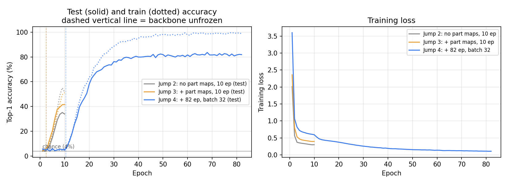
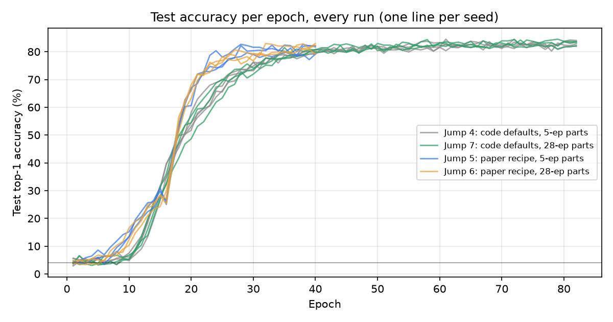
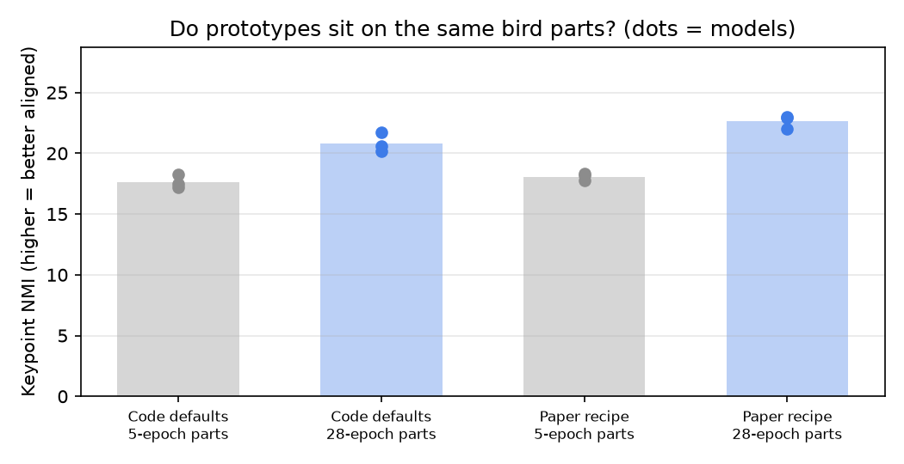
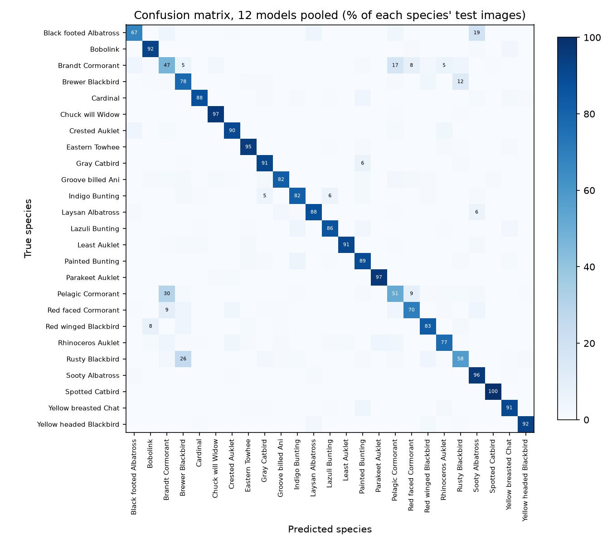
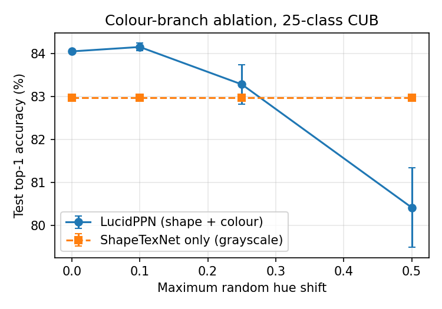
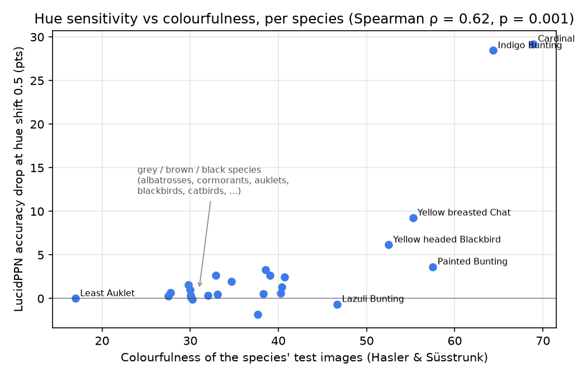
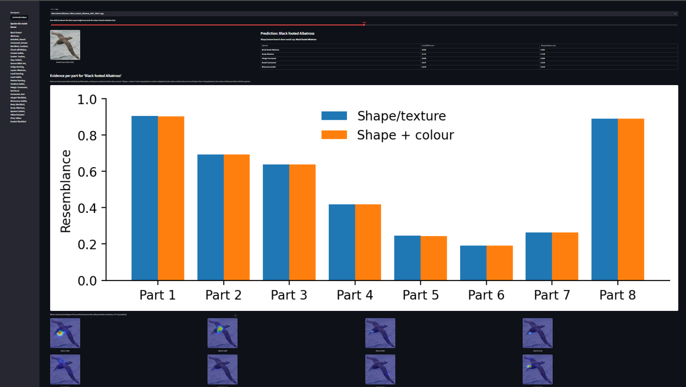
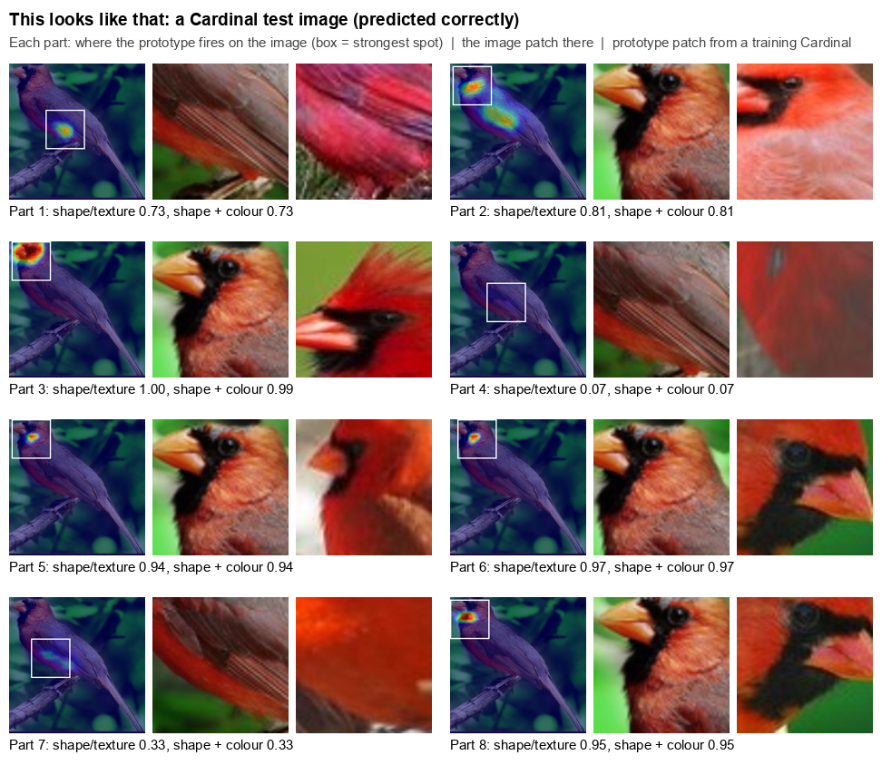

# Reproducing LucidPPN: Unambiguous Prototypical Parts for Interpretable Bird Classification

**Team:** Rayyan Saeed (31629), Laksh Kumar (30598), Ahmad Mustafa Khan (30496)
**Paper:** Pach, Lewandowska, Tabor, Zieliński, Rymarczyk. *LucidPPN: Unambiguous Prototypical Parts Network for
User-centric Interpretable Computer Vision.* ICLR 2025.
**Code:** https://github.com/rayyansgit/lucidppn-reproduction

> Draft status: all results are filled in. Rewrite every passage in your own voice before submitting (the brief
> assesses explanations in your own words), then delete this note.

---

## 1. Introduction and problem statement

Deep image classifiers are accurate but give no reason for their decisions. That matters wherever a person has to
trust, check or learn from the model. *Prototypical-part* networks are one answer: the model classifies an image by
finding patches that look like prototypical patches it learned from training images ("this part of the image looks
like that part of a Cardinal"). The explanation is the evidence itself.

LucidPPN starts from a weakness in these explanations: they are **ambiguous**. When a prototype fires on a patch of a
red bird's wing, the user cannot tell whether the model matched the *shape* of the wing, its *texture*, or its *red
colour*. Prototypes from different classes also fire on unrelated body parts, so comparing two classes' evidence is
hard. LucidPPN removes both ambiguities by design. Colour is processed by a separate branch from shape/texture, so
every prototype score can be split into a "shape/texture" part and a "colour" part. And each prototype is tied to a
fixed object part (head, wing, tail, ...) that is the same across all classes.

**Our goal** was to understand this method, reproduce it at a scale that fits free GPU compute, test one of its central
claims with an experiment of our own, and deploy the trained model as an app.

## 2. Literature and background

- **ProtoPNet** (Chen et al., 2019) introduced "this looks like that" classification: a CNN backbone, a layer of
  learned prototype vectors compared to every image patch, and a linear layer on the similarity scores.
- **ProtoPShare / ProtoPool** (Rymarczyk et al., 2021; 2022) share prototypes between classes to reduce their number.
  **PIP-Net** (Nauta et al., 2023) learns prototypes self-supervised so they match human notions of "the same part"
  better, and uses a sparse, non-negative classifier. PIP-Net is LucidPPN's direct baseline and the source of its
  augmentation and prototype-visualisation choices.
- **Ambiguity of prototypes.** Nauta et al. (2021) showed that users often cannot tell *why* a prototype matched,
  e.g. colour versus shape, and proposed explaining prototypes after the fact. LucidPPN instead builds that split into
  the architecture.
- **PDiscoNet** (van der Klis et al., 2023) discovers K object parts per image using only class labels (no part
  annotations). LucidPPN uses its part maps as weak supervision for where each prototype should fire.

What was missing before LucidPPN: a prototype network whose evidence is **disentangled** (colour vs shape/texture)
and **aligned** (prototype k always means object part k, in every class), without part annotations.

## 3. Paper methodology

LucidPPN has two branches and a training stage before them.

1. **Part discovery.** PDiscoNet (ResNet-101) is trained on the dataset with class labels only. It outputs K soft
   part-segmentation maps per image, which are saved once and used as training targets.
2. **ShapeTexNet** gets a *grayscale* copy of the image, so it cannot use colour. A CNN backbone produces a feature
   map, and a 1×1 convolution with sigmoid produces K·M channels (K parts × M classes). Channel (k, m) is a map of how
   much each location looks like "part k of class m". Max-pooling each channel gives the shape/texture resemblance r_S.
3. **ColorNet** sees only the colour of each pixel: a small per-pixel MLP (equivalently 1×1 convolutions: 3 → 20 → 50
   → 150 → 200 → 600 → K·M, sigmoid) on the RGB image downsampled to the feature-map size. Because it sees one pixel at
   a time, it cannot learn shape.
4. **Fusion.** The colour map is multiplied element-wise by a *stop-gradient* copy of the ShapeTexNet map, then
   max-pooled. This gives the fused score for each (part, class). The class score is the mean over the K parts. The
   stop-gradient means colour can only re-weight where ShapeTexNet already found the part, and colour never changes
   what ShapeTexNet learns.
5. **Losses** (all binary cross-entropy):
   - L_D aligns the ShapeTexNet map of the true class's prototype k with PDiscoNet's mask for part k.
   - L_S classifies with ShapeTexNet alone.
   - L_A classifies with the fused scores.
   - Weights: α_D = 1.4, α_S = α_A = 1.
6. **Explanation.** For a prediction, the user sees for each object part how well the shape/texture matched and how
   well the colour matched, next to prototype patches from training images.

**What is novel:** the architecture (colour/shape split with the one-way stop-gradient fusion) and the training signal
(PDiscoNet part maps aligning prototypes across classes). The backbone, classifier style and augmentation come from
PIP-Net.

**Paper's datasets and metrics:** CUB-200-2011, Stanford Cars, Stanford Dogs and Oxford Flowers, all fine-grained, where
both shape and colour matter. Metrics: top-1 accuracy, IoU between prototype maps and part masks, and user studies on
explanation clarity. Accuracy does not measure interpretability, which is why the user studies exist. IoU only measures
agreement with PDiscoNet, whose parts are themselves unsupervised.

**Headline results (paper, CUB):**
- Table 1: 81.5 ± 0.4% top-1, versus PIP-Net 84.3%.
- Table 2: ShapeTexNet alone 80.4%, versus 81.8% with ColorNet.
- Table 3: under random hue shifts, LucidPPN drops from 81.9% to 71.7%, ShapeTexNet stays at 80.3%, and PIP-Net
  drops from 83.9% to 53.0%.

**Limitations the authors flag:** a small accuracy cost against PIP-Net on CUB and Dogs, dependence on a separate
part detector, and colour being handled per pixel only (no colour patterns).

## 4. Implementation details

We forked the official repository and kept the authors' model, loss and training-step code unchanged, so that any
difference in results comes from scale and configuration, not from re-implementation bugs. We wrote the data
preparation, the training and evaluation drivers, the experiment code and the deployment. Every file is tagged as
reused, adapted or written by us in [`PROVENANCE.md`](PROVENANCE.md).

| | Paper | Ours | Why |
|---|---|---|---|
| Classes | 200 | 25 (CUB classes 1-25) | Free-tier Colab time |
| ShapeTexNet backbone | ConvNeXt-Tiny (~82% ImageNet top-1), 28×28 feature maps | ResNet18 (~70% ImageNet top-1), also 28×28 feature maps: the authors' ResNet code uses stride 1 in its last two stages | Speed / memory |
| Parts K | 12 | 8 | Default of the code |
| PDiscoNet | ResNet-101, 448 px, 28 epochs | ResNet-101, 224 px, 5 epochs (28 epochs in the follow-up study) | Time |
| Epochs | 40 | 80 (+2 in which only ColorNet still trains) | Jump 4 change |
| Batch size | 64 | 32 | Memory / Jump 4 change |
| ShapeTexNet learning rate | 0.002 → 0.0002 | 0.0005 → 0.00005 | Code default |
| ColorNet learning rate | 0.002, fixed | 0.0005, and 0 for the first 2 epochs | Code default |
| Frozen warm-up | 15 epochs; last backbone block still trains | 10 epochs; only the 1×1 prototype layer trains (ResNet18 has no `layer4.2`) | Code written for deeper backbones |
| Part-alignment weight α_D | 1.4 | 1.0 | Code default |
| Optimiser, weight decay, image size, augmentation | AdamW, 0, 224, TrivialAugment without colour | same | — |
| Runs | 3 seeds | Stage 3: 1 seed; follow-up study: 3-4 runs per configuration (Section 6.2) | Time |

Several of these differences come from using the official code's default arguments, which don't match the values
given in the paper's supplement (learning rates, α_D, epochs).

Workflow, as the brief recommends:
1. A one-batch forward pass checking shapes and NaNs (`MetiNet/forward_pass_test.py`, `forward_pass_log.txt`).
2. A tiny subset (8 classes).
3. 25 classes without and then with part maps.
4. A long run.

Every run logs loss and train/test accuracy per epoch, to TensorBoard and to text logs kept in the repo. We evaluate
with the authors' `topk_accuracy`. We had to rewrite the evaluation loop for training, because the upstream
`test.py` computes part-IoU and crashed without part maps. Once part maps were available we added a full evaluation
script (`MetiNet/eval_full.py`) that also computes the paper's IoU with the authors' definition (Section 6.3).

Environment: Google Colab (T4 GPU) for Stages 3-5, with dependencies pinned in `requirements_pip.txt`; a local
RTX 2080 Max-Q laptop GPU for the follow-up study (PyTorch 2.11, CUDA 12.8).

**Follow-up study (after Stage 4).** Once Stages 3-5 were complete, we used the remaining time for a 2 × 2 study with
3 seeds per configuration (`experiments/`, commands in `experiments/README.md`):
- *Training recipe:* the official code's default arguments (our Jump 4) versus the authors' own launch script
  `MetiNet/run_training.sh`. That script matches the paper's supplement exactly (40 epochs, 15 frozen, lr 0.002 for
  both branches, ColorNet trained from epoch 1, α_D = 1.4, batch 64). The published configuration is only in the
  launch script; the code's defaults differ from it.
- *Part detector:* PDiscoNet trained for 5 epochs (as in Stage 3) or for the paper's 28 epochs.
- Backbone (ResNet18), K = 8 parts, the 25 classes and the evaluation stay the same. Every model then also went
  through the Stage 4 colour ablation.

To run this locally we made `train_quick.py` Windows-safe (parallel data loading) and added options for the part-map
folder and output folder, without changing its defaults. We also adapted the authors' part-quality evaluation
(`evaluate_cub.py`) to our 25 classes.

## 5. Dataset and preprocessing

**CUB-200-2011** (Wah et al., 2011): 11,788 photos of 200 North American bird species with bounding boxes. It is
freely downloadable for research. We use the first 25 species, giving **750 training and 652 test images** with the
official train/test split. As in the paper, each image is cropped to its bounding box (`prepare_cub_subset.py`).

At training time we use the authors' augmentation: resize to 232, TrivialAugment restricted to geometric operations
(no colour changes, which would corrupt what ColorNet learns), horizontal flip, and a random crop to 224. At test time
we only resize to 224. ShapeTexNet receives a grayscale image normalised with mean 0.445 and std 0.269. ColorNet
receives the RGB image.

PDiscoNet is trained on the same 25 classes (full images, 224 px). It then writes 8 part maps for every cropped
train/test image, which MetiNet loads as targets.

**Implication of the subset:** with 25 classes, chance is 4% instead of 0.5%. Many confusable species (e.g. most
sparrows and warblers) are not in our subset, so our accuracy is not comparable to the paper's 200-class number.

## 6. Reproduction results

### 6.1 Stage 3 runs

| Run | Change | Test top-1 |
|---|---|---|
| Jump 1 | Untrained forward pass | sanity check only |
| Jump 2 | 10 epochs, no part maps (α_D = 0) | 33.9% |
| Jump 3 | 10 epochs, with PDiscoNet part maps | 41.6% |
| Jump 4 | 82 epochs, batch 32, 10 frozen epochs | **81.9%** |
| Jump 4 rerun | Same scripts and settings, run again for Stages 4-5 | **84.0%** |
| Paper (Table 1) | 200 classes, ConvNeXt-Tiny, 3 seeds | 81.5 ± 0.4% |

We report the last epoch of each run. Jump 4 peaked at 83.6% at epoch 68, but we found that epoch by looking at test
accuracy, so reporting it would be selecting on the test set.

**Reproducibility check.** The Stage 3 checkpoint was only stored in Colab's temporary storage and was lost, so we
retrained Jump 4 with the unmodified scripts and settings (log: `MetiNet/training_log_JUMP4_rerun.txt`). The rerun
followed the original closely: chance-level until the backbone unfroze, ~52% at epoch 20, ~79% at epoch 40, then a
plateau. It finished at 84.0% versus 81.9%. The 2.1-point difference comes only from GPU non-determinism, with
identical code, data and seed. It shows the run-to-run spread is about ±1 point, larger than the paper's ±0.4 over
200 classes, as expected with a 652-image test set (one image = 0.15 points). Our Stage 4 experiment and the deployed
app use the rerun checkpoint.

### 6.2 Follow-up study: training recipe × part detector, 3 seeds each

**Part-detector quality**, measured with the authors' metrics against CUB's 15 annotated keypoints (25-class test set):

| Part detector | NMI ↑ | ARI ↑ | Keypoint regression error ↓ |
|---|---|---|---|
| 5 epochs (Stage 3) | 24.1 | 11.8 | 14.3% |
| 28 epochs (paper's length) | **31.0** | **14.9** | **12.7%** |

NMI and ARI measure how consistently each discovered part lands on the same annotated body region across birds;
keypoint regression error measures how well the part centres predict the true keypoint locations. With 5 epochs,
PDiscoNet's learning-rate decay (every 5 epochs) never took effect.

**Classification** (test top-1 at the final epoch, mean ± std over runs):

| | 5-epoch part detector | 28-epoch part detector |
|---|---|---|
| Code defaults, 82 epochs (Jump 4 / Jump 7) | **83.1 ± 1.0** (4 runs) | 83.0 ± 0.7 (3 runs) |
| Paper recipe, 40 epochs (Jump 5 / Jump 6) | 81.0 ± 1.7 (3 runs) | 81.4 ± 2.0 (3 runs) |
| Paper, Table 1 (200 classes, ConvNeXt-Tiny) | 81.5 ± 0.4 | |

The code-defaults / 5-epoch cell includes the team's original Jump 4 run (81.9%) and the rerun (84.0%).

### 6.3 Full evaluation: top-5, per-species errors and part alignment

`MetiNet/eval_full.py` evaluates every trained model on the test set with both of the paper's metric families. Full
tables: `experiments/EVALUATION.md`.
- **Classification:** top-1 and top-5 accuracy, per-species accuracy and the confusion matrix.
- **Part alignment (the paper's IoU):** overlap between each part's prototype map and the PDiscoNet mask for that
  part, using the authors' definition from `metinet/test.py` (it failed in Stage 3 only because the part maps were
  missing). Because PDiscoNet's parts are unsupervised and numbered arbitrarily, IoU is measured against the masks each
  model was trained with.
- **Part alignment against human annotations (comparable across all models):** at each of CUB's 15 annotated
  keypoints (beak, eye, crown, wing, tail, ...; 7,571 visible keypoints in the test set), which part's prototype is
  strongest. NMI/ARI then measure how consistently each prototype lands on the same body part, the metric
  PDiscoNet's authors use for part discovery, applied to LucidPPN's prototype maps.

| Configuration (3 models each) | Top-1 | Top-5 | IoU with own masks | Keypoint NMI ↑ | Keypoint ARI ↑ |
|---|---|---|---|---|---|
| Code defaults, 5-epoch parts | 83.5 ± 0.6 | 97.9 ± 0.2 | 0.33 ± 0.01 | 17.6 ± 0.6 | 8.6 ± 0.3 |
| Code defaults, 28-epoch parts | 83.0 ± 0.7 | 97.8 ± 0.2 | 0.27 ± 0.01 | **20.8 ± 0.8** | **10.4 ± 0.2** |
| Paper recipe, 5-epoch parts | 81.0 ± 1.7 | 97.2 ± 0.5 | **0.44 ± 0.03** | 18.1 ± 0.3 | 8.6 ± 0.2 |
| Paper recipe, 28-epoch parts | 81.4 ± 2.0 | 97.2 ± 0.5 | 0.31 ± 0.01 | **22.6 ± 0.6** | **11.1 ± 0.3** |

(The code-defaults / 5-epoch row here covers the 3 models with a checkpoint: the rerun and seeds 2-3.)

**Where the errors are.** Pooled over all 12 models, almost all errors fall inside three groups of near-identical
dark species: Pelagic Cormorant is predicted as Brandt's Cormorant on 30% of its test images, Rusty Blackbird as
Brewer's Blackbird on 26%, and Black-footed Albatross as Sooty Albatross on 19%. These are the hardest species
(47-67% accuracy), while 10 species are above 90%.

## 7. Additional experiment: is the colour branch worth it?

**Question:** how much of our LucidPPN's accuracy comes from the ColorNet branch, and how much robustness to colour
changes does that cost? (Experiment type A, ablation.)

**Method:**
- We take the Jump 4 model and compute two predictions for every test image: the full LucidPPN output, and
  ShapeTexNet alone (mean of the grayscale prototype scores).
- We repeat this with the test images' hue randomly rotated by up to 0.1, 0.25 and 0.5 of the colour wheel, keeping
  each pixel's brightness. We use the authors' perturbation function, and each level is averaged over 3 random seeds.
- We also count how often adding colour fixes a wrong ShapeTexNet prediction, or breaks a right one.

Removing ColorNet needs no retraining. The fused score uses a stop-gradient copy of the ShapeTexNet map, so ColorNet's
loss never updates ShapeTexNet. The ShapeTexNet inside the trained model is therefore the same model as one trained
without ColorNet.

### 7.1 First run: one model

**Results** (Jump 4 rerun checkpoint, 652 test images; hue-shifted rows are mean ± std over 3 seeds; output of
`MetiNet/eval_ablation.py`, saved in `MetiNet/results/`):

| Max hue shift | LucidPPN top-1 | ShapeTexNet top-1 | Colour helped | Colour hurt |
|---|---|---|---|---|
| 0.0 (clean) | 84.0 | 83.0 | 1.8 | 0.8 |
| 0.1 | 84.2 ± 0.1 | 83.0 | 1.8 | 0.7 ± 0.1 |
| 0.25 | 83.3 ± 0.5 | 83.0 | 1.7 ± 0.2 | 1.4 ± 0.6 |
| 0.5 | 80.4 ± 0.9 | 83.0 | 1.0 ± 0.4 | 3.6 ± 0.6 |

"Colour helped" is the share of test images where ShapeTexNet alone is wrong but LucidPPN is right; "colour hurt" is
the reverse.

Side by side with the paper (CUB, 200 classes):

| | Paper | Ours (25 classes) |
|---|---|---|
| ShapeTexNet → LucidPPN, clean (Table 2) | 80.4 → 81.8 (+1.4) | 83.0 → 84.0 (+1.1) |
| LucidPPN, clean → hue-perturbed (Table 3) | 81.9 → 71.7 (−10.2) | 84.0 → 80.4 (−3.6) |
| ShapeTexNet, clean → hue-perturbed (Table 3) | 80.3 → 80.3 (0) | 83.0 → 83.0 (0) |

On this one model, colour fixed 12 test images and broke 5. An exact McNemar test gives p ≈ 0.14, so one model could
not show whether the gain is real. We therefore repeated the experiment on every model from the follow-up study.

### 7.2 Repeated on all 12 trained models

Same evaluation, now with 5 hue-perturbation seeds and per-species results, on the Jump 4 rerun and the 11 models of
Section 6.2 (`experiments/*/ablation/`).

| Configuration | ShapeTexNet only | Colour gain (clean) | Change at hue shift 0.5 |
|---|---|---|---|
| Code defaults, 5-epoch parts (3 models) | 82.1 ± 0.9 | +1.5 ± 0.4 | −3.3 ± 0.7 |
| Code defaults, 28-epoch parts (3) | 81.5 ± 0.6 | +1.5 ± 0.8 | −4.4 ± 0.5 |
| Paper recipe, 5-epoch parts (3) | 79.6 ± 0.9 | +1.4 ± 0.9 | −4.0 ± 3.7 |
| Paper recipe, 28-epoch parts (3) | 80.4 ± 1.9 | +1.1 ± 0.4 | −4.5 ± 2.6 |

| Over all 12 models | Ours | Paper (200 classes) |
|---|---|---|
| Colour gain on clean images (LucidPPN − ShapeTexNet) | **+1.4** (positive in 12/12; sign test p = 0.0005) | +1.4 |
| LucidPPN change at hue shift 0.5 | **−4.1** (negative in 11/12) | −10.2 |
| ShapeTexNet change at hue shift 0.5 | **0** (every model) | 0 |

Pooled over all models, colour fixed 162 test decisions and broke 55.

### 7.3 Which species are affected?

For every species we computed how colourful its test images are (the Hasler & Süsstrunk colourfulness metric) and
how much LucidPPN's accuracy on it drops at hue shift 0.5, averaged over the 12 models.

The drop correlates with colourfulness (Spearman ρ = 0.62, p = 0.001, 25 species). The 12 most colourful species lose
7.2 points on average, the 12 least colourful 0.8. Cardinal (−29) and Indigo Bunting (−28) account for most of the
effect; albatrosses, cormorants and auklets barely change. Full table: `experiments/colour_by_species.md`.

### Answer to our question

The colour branch adds about **1.4 points** of accuracy, the same as the paper reports, and the gain is consistent: it
is positive in all 12 models. The cost is robustness: under strong hue changes LucidPPN loses about **4 points** on
average and drops below the shape-only branch, while the shape/texture branch is completely unaffected. The size of
that cost depends on the species: colourful birds lose up to 29 points, grey birds almost nothing.

## 8. Analysis and discussion

### 8.1 Reproduction

**Part supervision mostly reduces overfitting.** Adding PDiscoNet maps (Jump 2 → 3) raised test accuracy by 7.7
points at the same train accuracy (~51%). The train-test gap fell from about 18 to about 10 points. This matches the
paper's ablation (their Fig. 6), where removing the alignment loss hurt accuracy and made prototypes collapse onto one
part. In our setting it acts as a regulariser: it forces each part's prototype to look at a specific region rather
than whichever single region is most discriminative.

**Training length mattered most, and the warm-up was wasted, mainly because of the learning rate.** In Jump 4 test
accuracy stays at chance for the whole frozen warm-up (≤ 6% at epoch 10) and only rises once the backbone is
unfrozen. Our first explanation was that the authors' code only trains a block named `layer4.2` during warm-up,
which ResNet18 does not have. The follow-up study corrected this. With the paper's 4× higher learning rate, the model
*does* learn while the backbone is frozen (~14% at epoch 10, 28-31% at epoch 15). So the dead warm-up was mainly
caused by the low default learning rate. Jump 4's +40 points come from 72 rather than 8 epochs of full fine-tuning.
Accuracy plateaus around epoch 40-60, while train accuracy approaches 99% and the train-test gap widens back to ~17
points. The model memorises the 750 training images, but test accuracy does not fall, so the extra epochs are wasted
compute rather than harmful.

**Why our accuracy matches the paper's despite a weaker model.** Two effects pull in opposite directions. Our model
is weaker: ResNet18 instead of ConvNeXt-Tiny (about 70% vs 82% top-1 on ImageNet), 8 instead of 12 parts, and a
shorter-trained PDiscoNet. Our task is much easier: 25 classes instead of 200, and the hardest look-alike groups are
missing. The second effect clearly dominates, so the matching numbers are a coincidence, not a reproduction of the
paper's figure. The feature-map resolution, on the other hand, matches the paper: the authors' ResNet code removes the
last two downsampling steps, so our prototype maps are 28×28 (each cell covers 8×8 pixels), like their ConvNeXt
maps.

**Run-to-run spread is about ±1-2 points.** Our 3-4 runs per configuration vary by 0.7-2.0 points (standard
deviation), against the paper's ±0.4. The difference is expected: one of our 652 test images is worth 0.15 points,
while the paper tests on 5,794. Any single-run difference of up to ~2 points, including Jump 4's 81.9% vs the rerun's
84.0%, is noise.

### 8.2 Following the paper more closely

**The paper's recipe does not transfer one-to-one to a small subset.** It learns faster early (about 75% by epoch 25,
against about 68% for the code defaults) but ends about 2 points lower (81.0-81.4% vs 83.0-83.1%). With 750 training
images and batch 64, its 40 epochs make only about 440 weight updates, against about 1,900 for Jump 4. The paper's
schedule was designed for all 200 classes, 8× more images. Hyperparameters are tied to dataset size, so "using the
paper's settings" is not automatically "reproducing the paper" at a different scale.

**Better parts gave better explanations, not better accuracy.** The 28-epoch part detector is clearly better on
all three part metrics (NMI 24.1 → 31.0), yet classification accuracy did not change (83.1 vs 83.0; 81.0 vs 81.4,
well inside the seed spread). What did change is where the prototypes look: measured against CUB's human-annotated
keypoints, prototypes trained with the better parts sit far more consistently on the same body parts (keypoint NMI
17.6 → 20.8 with the code defaults, 18.1 → 22.6 with the paper recipe; every 28-epoch model beats every 5-epoch
model). The stronger alignment weight of the paper recipe (α_D = 1.4) also makes prototypes follow their part masks
more closely (IoU 0.33 → 0.44 with the same masks). So part supervision affects the *explanation*, while
classification only needs parts to be roughly right; the part loss acts mainly as a regulariser for accuracy. This
mirrors the paper's own Fig. 6, where stronger part alignment improves IoU much more than accuracy. The prototype
patches in the app (Section 9) show the remaining weakness: several prototypes still concentrate on the head and
beak, the most distinctive region, rather than spreading evenly over the body.

### 8.3 The colour branch

- **The colour gain is real, small and consistent.** +1.4 points, positive in 12 of 12 models (p = 0.0005), the same
  size as the paper's +1.4. Colour works as a tie-breaker on a few images (on average about 14 fixed vs 5 broken per model),
  not as a main source of evidence.
- **The shape branch is exactly flat under hue shift, in every model.** The perturbation keeps each pixel's
  brightness and ShapeTexNet only ever sees brightness, so its input and accuracy are identical at every hue level.
  Reproducing this exactly confirms that the two branches really are separated, in the authors' code and in our use
  of it.
- **Colour becomes a liability once colours are implausible.** Mild shifts (≤ 0.1) change nothing. From about 0.25
  upwards colour hurts more often than it helps, and at 0.5 the full model falls below shape-only: a red cardinal
  turned blue gives wrong colour evidence that outweighs correct shape evidence.
- **Why our average drop (−4.1) is less than half the paper's (−10.2).** The per-species analysis answers this:
  hue sensitivity is concentrated in colourful species (ρ = 0.62), and our 25 species are mostly grey, brown and black
  (albatrosses, auklets, cormorants, blackbirds). Rotating the hue of an unsaturated pixel barely changes it, so for
  most of our test set the perturbation does almost nothing. The full 200-class CUB has many more colour-defined
  species (warblers, tanagers, orioles). Input resolution is not the explanation: ColorNet sees the image at the
  same 28×28 resolution as in the paper.
- **How much a model relies on colour varies a lot between seeds.** With identical settings, the hue-shift change
  ranged from +0.2 to −6.6 points (paper recipe). Models whose ColorNet output varied more with pixel colour tended to
  lose more. A single-model ablation, like our first run, can therefore give a misleading picture of colour reliance.
- **What this means for the paper's claim.** The trade-off the authors describe holds: separating colour costs
  nothing in shape-based accuracy, adds a little clean accuracy, and makes colour reliance measurable and visible per
  part. That last point is exactly what a single-branch model cannot offer. But how much colour matters depends on the
  dataset, so the paper's −10.2 sensitivity is a property of CUB's species mix, not a fixed property of the
  architecture.

### 8.4 What we learnt

1. **Measure the noise before comparing.** Our first Stage 4 result looked like a gain but was not significant; our
   first reading of Jump 4 credited a change that was within the seed spread. Three seeds per configuration turned
   both into clear statements.
2. **Read the authors' launch scripts, not only the defaults.** The paper's real configuration was in
   `run_training.sh`; the argument defaults differ in six settings (epochs, frozen epochs, three learning rates, part weight).
3. **Hyperparameters are tied to dataset size.** The paper's 40-epoch schedule makes 4× fewer updates on our subset.
4. **Measure what a component is for.** Better parts left accuracy unchanged, so judged on accuracy alone they
   looked useless. Measured on part alignment, the quantity they are meant to improve, they clearly helped. An
   interpretability method needs interpretability metrics, not only accuracy.
5. **The test data shapes the conclusion.** Colour reliance depends on which species are in the subset; an average
   over mostly grey birds hides a 29-point effect on a cardinal.
6. **Log everything, every epoch.** The warm-up problem, the plateau and the overfitting were only visible because
   each run logged train and test accuracy per epoch.
7. **Never select on the test set, and save artefacts persistently.** We report final epochs only, and losing the
   Stage 3 checkpoint with the Colab session cost us a full retraining.

## 9. Deployment

We deploy the Jump 4 model in two ways that share one inference module (`deploy/lucid_inference.py`). Preprocessing
is copied from the test-time branch of the training data pipeline, so training and serving cannot drift apart.

- **Streamlit web app** (`streamlit run deploy/app.py`):
  - The user uploads a bird photo or picks a test image.
  - It shows the top-5 species as a "share of evidence" bar chart (each species' score divided by the sum over all
    25 species, adding up to 100%), with the full-model score and the shape-only score side by side. Because the model
    scores every species independently (per-species sigmoid, binary cross-entropy), these shares are normalised
    scores, not calibrated probabilities.
  - For test images it shows the true species and whether the prediction is correct.
  - A bar chart compares, for each of the 8 parts, the shape/texture match with the shape+colour match.
  - **"This looks like that":** for each of the 8 parts, a heatmap of where its prototype fires on the image, the
    image patch at the strongest spot, and the *prototype patch*: the patch of a training image of the predicted
    species where the same prototype fires most strongly (`deploy/build_prototypes.py`, precomputed for all
    25 species × 8 parts). This is the paper's prototype visualisation.
  - A hue slider recolours the bird live, which demonstrates the Stage 4 experiment interactively.
- **FastAPI REST API** (`uvicorn deploy.api:app`): `POST /predict` with an image file returns JSON (prediction, top-k,
  per-part evidence). `GET /classes` lists the 25 species. Interactive docs are at `/docs`.

Commands, input/output formats and a worked example are in [`deploy/README.md`](deploy/README.md). On Colab, the
notebook starts both and exposes the app through a Cloudflare tunnel.

**Worked example (API).** We sent a Cardinal test image twice, once unchanged and once with the hue rotated by 0.5
(red becomes cyan, brightness unchanged). Full responses: `deploy/example_response_cardinal.json`.

| | Normal colours | Hue shifted by 0.5 |
|---|---|---|
| Prediction | Cardinal | Cardinal |
| LucidPPN score for Cardinal | 0.725 | 0.368 |
| Share of evidence for Cardinal | 71% | 46% (Gray Catbird rises to 21%) |
| Shape/texture-only score | 0.726 | 0.727 |
| Parts with shape + colour ≈ 0 | none | 4 of 8 (parts 1, 2, 3, 7) |

In this example the Cardinal's crest, black face mask and orange beak (parts 2, 3, 5, 6, 8) are matched to the same
features on training Cardinals, and its red wing and body (parts 1, 4, 7) to red plumage. It also shows that five of
the eight prototypes concentrate on the head: PDiscoNet's parts are not used evenly.

**What the app shows beyond the aggregate numbers.** The hue slider makes the Stage 4 result visible per image and
per part. For the red Cardinal, half of the parts lose all colour evidence and the score halves. For the grey
Black-footed Albatross the score falls by about 15% (0.530 → 0.45), from two parts only. For the dark Rusty Blackbird
it doesn't change at all (0.324 → 0.328 at a −0.40 shift). In all three cases the shape-only score stays fixed and the
prediction survives. These single images match the per-species analysis of Section 7.3: most of our 25 species have
little colour to perturb. It also shows the interpretability the paper argues for: a user can see
*which* parts matched on colour, which a single-branch model cannot show.

The app runs on a laptop CPU with the trained checkpoint (0.2 s to load, about 0.1 s per image), so the
demonstration doesn't depend on Colab.

**Deployment limitations:**
- The model only knows 25 species and will force any other bird into one of them.
- It expects a tight crop around the bird.
- Part numbers have no names, because PDiscoNet's parts are unsupervised.
- Anyone can run it: `run_demo.bat` / `run_demo.sh` set up the environment and start the app straight after cloning
  (the trained model and 25 example images are in the repository).

## 10. Limitations

- **Scale:** 25 of 200 classes, a weaker backbone (ResNet18 instead of ConvNeXt-Tiny, at the same 28×28 feature-map
  resolution) and 8 instead of 12 parts. Our accuracy is not comparable to the paper's headline number.
- **Subset composition:** our first 25 species are mostly grey, brown and black. Colour-related results (Section 7)
  depend on that mix and would be stronger on a colourful subset or the full dataset.
- **No validation split:** we evaluated on the test set every epoch. We only report final-epoch numbers to avoid
  test-set selection, but the Jump 3-4 settings were chosen after seeing earlier test results.
- **Bundled changes in Stage 3:** Jump 4 changed epochs, warm-up length and batch size together. The follow-up study
  changed one factor per axis, but the "paper recipe" is itself a bundle of settings (as published).
- **The paper recipe was not re-tuned for our smaller dataset** (for example, more epochs to match its number of
  weight updates).
- **The warm-up stayed ineffective with the default learning rate** (Section 8.1); we did not make it train
  ResNet18's last block (`layer4.1`).
- **PDiscoNet at 224 px rather than 448**, and its better parts were not tested with finer feature maps.
- **Not reproduced:** the user studies, the other three datasets, and the PIP-Net comparison.
- **Part-alignment metrics depend on references:** IoU is measured against PDiscoNet's own (unsupervised) masks, and
  our keypoint NMI/ARI is our adaptation of PDiscoNet's metric to prototype maps, not a metric reported in the paper.
- **The colour experiment is evaluation-only** (valid because of the stop-gradient, Section 7) and only tests hue,
  not saturation or lighting changes.

Addressed in the follow-up study (they were limitations of Stages 3-4): single-seed results (now 3-4 runs per
configuration), unchecked part quality (now measured), the paper's recipe (now tested), the significance of the
colour gain (now p = 0.0005), the reason for our small hue-shift drop (now explained per species), and the
paper's second metric, prototype-part IoU (now measured, plus a keypoint-based alignment score).

**What we would do with more time**, most valuable first:
1. Hold out a validation split (e.g. 5 training images per class) for choosing epochs and settings.
2. Use the paper's backbone (`convnext_tiny_26`, which the code supports), a much stronger feature extractor, and
   re-test whether the better part detector (and a 448 px one) pays off there.
3. Run a small user study, as the paper does, to test whether the better-aligned prototypes are actually easier
   for people to understand.
4. Repeat the colour experiment on a colourful 25-species subset (warblers, tanagers, orioles), or on all 200 classes.
5. Re-tune the paper recipe for small data (match the number of weight updates) and fix the warm-up for ResNet18.
6. Test other colour changes (saturation, lighting) besides hue.

## 11. Conclusion

We reproduced LucidPPN's full three-stage pipeline (PDiscoNet part discovery, then the two-branch prototype network
with part alignment, then evaluation) on a 25-class subset of CUB, using the authors' model code with our own data and
training drivers. Our Stage 3 model reached 81.9% top-1, and over four runs the same configuration gives
83.1 ± 1.0%. Part supervision clearly reduced overfitting, as the paper's ablation predicts.

Our experiment asked how much the colour branch contributes and what it costs. Over 12 models, colour adds +1.4 points,
the same as the paper, positive in every model (p = 0.0005). Under strong hue changes the full model loses about 4
points while the shape-only branch loses nothing. That cost falls almost entirely on colourful species (Cardinal −29,
grey birds about 0), which explains why it is smaller than the paper's −10.2 on our mostly grey subset. So the
paper's trade-off holds, but its size depends on the dataset.

Following the paper more closely taught us as much as reproducing it. The authors' published recipe, found in their
launch script, ended about 2 points lower on our small subset, because it makes 4× fewer weight updates on 8× fewer
images. A part detector trained for the paper's 28 epochs found clearly better parts. It gave no accuracy gain, but
it made the prototypes sit more consistently on real bird parts (keypoint NMI up by 3-4.5 points in every model):
part supervision improves the explanations, which is what it is for. Most remaining errors are between near-identical
dark species (cormorants, blackbirds, albatrosses), where colour cannot help. And with 652 test images, differences below about 2 points are noise: several seeds were
needed before any of these conclusions could be stated.

Finally, we deployed the model as an interactive app and a REST API that show the paper's main selling point: for
every prediction, the user can see which parts matched on shape and which on colour, and watch the colour evidence
disappear when the bird is recoloured.

## 12. References

1. M. Pach, K. Lewandowska, J. Tabor, B. Zieliński, D. Rymarczyk. LucidPPN: Unambiguous Prototypical Parts Network for
   User-centric Interpretable Computer Vision. ICLR 2025.
2. C. Chen, O. Li, D. Tao, A. Barnett, C. Rudin, J. Su. This Looks Like That: Deep Learning for Interpretable Image
   Recognition. NeurIPS 2019.
3. M. Nauta, J. Schlötterer, M. van Keulen, C. Seifert. PIP-Net: Patch-Based Intuitive Prototypes for Interpretable
   Image Classification. CVPR 2023.
4. R. van der Klis, S. Alaniz, M. Mancini, C. Dantas, D. Ienco, Z. Akata, D. Marcos. PDiscoNet: Semantically
   Consistent Part Discovery for Fine-grained Recognition. ICCV 2023.
5. D. Rymarczyk, Ł. Struski, J. Tabor, B. Zieliński. ProtoPShare: Prototypical Parts Sharing for Similarity Discovery
   in Interpretable Image Classification. KDD 2021.
6. D. Rymarczyk, Ł. Struski, M. Górszczak, K. Lewandowska, J. Tabor, B. Zieliński. Interpretable Image Classification
   with Differentiable Prototypes Assignment (ProtoPool). ECCV 2022.
7. M. Nauta, A. Jutte, J. Provoost, C. Seifert. This Looks Like That, Because ... Explaining Prototypes for
   Interpretable Image Recognition. ECML PKDD Workshops 2021.
8. C. Wah, S. Branson, P. Welinder, P. Perona, S. Belongie. The Caltech-UCSD Birds-200-2011 Dataset. Caltech
   Technical Report CNS-TR-2011-001, 2011.
9. K. He, X. Zhang, S. Ren, J. Sun. Deep Residual Learning for Image Recognition. CVPR 2016.
10. Z. Liu, H. Mao, C.-Y. Wu, C. Feichtenhofer, T. Darrell, S. Xie. A ConvNet for the 2020s. CVPR 2022.
11. S. G. Müller, F. Hutter. TrivialAugment: Tuning-free Yet State-of-the-Art Data Augmentation. ICCV 2021.
12. D. Hasler, S. Süsstrunk. Measuring Colourfulness in Natural Images. Proc. SPIE Human Vision and Electronic Imaging
    VIII, 2003.
13. Q. McNemar. Note on the Sampling Error of the Difference Between Correlated Proportions or Percentages.
    Psychometrika 12, 1947.
