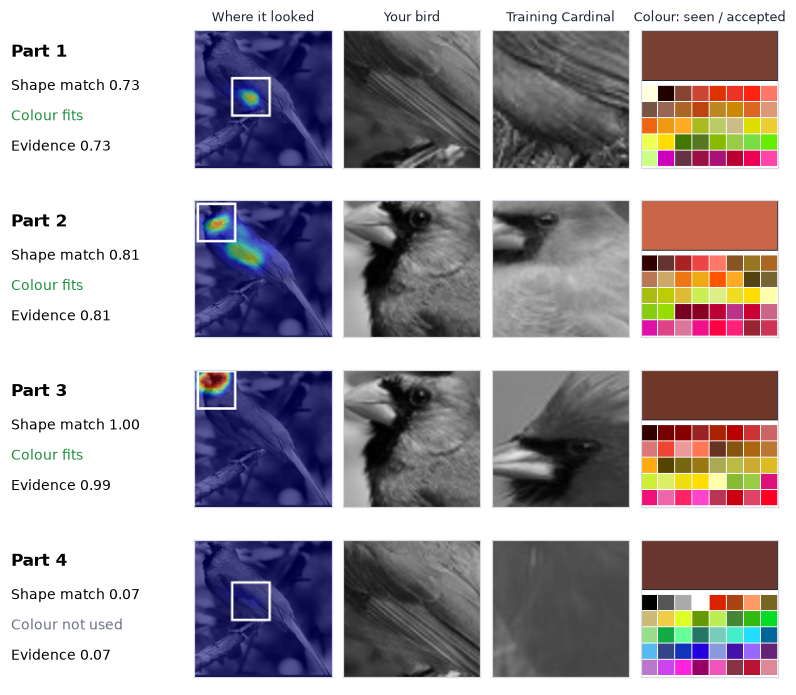

# Reproducing LucidPPN: Unambiguous Prototypical Parts for Interpretable Bird Classification

**Team:** Rayyan Saeed (31629), Laksh Kumar (30598), Ahmad Mustafa Khan (30496)

**Paper:** Pach, Lewandowska, Tabor, Zieliński, Rymarczyk. *LucidPPN: Unambiguous Prototypical Parts Network for
User-centric Interpretable Computer Vision.* ICLR 2025.

**Code:** https://github.com/rayyansgit/lucidppn-reproduction (branch `m3&m4`)

## 1. Introduction and problem statement

Image classifiers are accurate, but they do not say why they reached a decision. Prototypical-part networks address
this by classifying an image through comparisons with parts of training images: "this part of the image looks like
that part of a Cardinal". The comparison itself is the explanation.

LucidPPN points out that these explanations are ambiguous. When a prototype matches the red wing of a bird, the user
cannot tell whether the match was on the wing's shape, its texture or its colour. Prototypes of different classes
also attach to different body parts, so two classes cannot be compared part by part. LucidPPN removes both problems
by design: colour is handled by a separate branch, and each prototype is tied to the same object part in every class.

Our goals were to reproduce the method at a scale that fits our compute, to test one of its central claims with an
experiment of our own, and to deploy the trained model as an application that shows the explanation.

## 2. Background

- **ProtoPNet** (Chen et al., 2019) introduced classification by comparing image patches with learned prototype
  vectors and scoring classes from those similarities.
- **ProtoPShare and ProtoPool** (Rymarczyk et al., 2021, 2022) share prototypes between classes. **PIP-Net**
  (Nauta et al., 2023) learns prototypes that better match human notions of a part and is LucidPPN's direct baseline.
- **Nauta et al. (2021)** showed that users often cannot tell whether a prototype matched on colour or on shape, and
  proposed explaining prototypes after training. LucidPPN builds that separation into the architecture instead.
- **PDiscoNet** (van der Klis et al., 2023) discovers object parts from class labels only. LucidPPN uses its part maps
  as weak supervision for where each prototype should fire.

## 3. The paper's method

1. **Part discovery.** PDiscoNet (ResNet-101) is trained with class labels only and produces K part maps per image.
2. **Shape branch (ShapeTexNet).** A CNN receives a grayscale copy of the image. A 1 x 1 convolution with a sigmoid
   gives K x M maps (K parts, M classes); map (k, m) shows how much each location looks like part k of class m.
3. **Colour branch (ColorNet).** A small network applied to one pixel at a time, on the image downsampled to the
   feature-map size. Because it sees single pixels, it can learn colour but not shape.
4. **Fusion.** The colour map multiplies a stop-gradient copy of the shape map, and the product is max-pooled per part.
   A class score is the mean over its K parts. Colour can therefore only confirm or suppress what the shape branch
   found, and the colour branch never changes what the shape branch learns.
5. **Losses** (binary cross-entropy): part alignment of shape maps with PDiscoNet's masks (weight 1.4), classification
   with the shape branch alone, and classification with the fused scores.

**Novelty:** the colour/shape split with one-way fusion, and the part alignment that gives prototype k the same meaning
in every class. **Datasets:** CUB-200-2011, Stanford Cars, Stanford Dogs, Oxford Flowers. **Metrics:** top-1 accuracy,
IoU between prototype maps and part masks, and user studies.

**Headline results on CUB:** 81.5 ± 0.4% (PIP-Net 84.3%); shape branch alone 80.4% against 81.8% for the full model;
under random hue changes the full model drops from 81.9% to 71.7%, the shape branch stays at 80.3%, and PIP-Net drops
from 83.9% to 53.0% (Tables 1-3). The authors note that the colour mechanism cannot capture other visual features such
as texture or contrast, and that the model inherits known prototypical-part issues such as spatial misalignment.

## 4. Implementation

We forked the official repository and kept the authors' model, loss and training-step code unchanged, so that
differences in results come from scale and configuration rather than re-implementation errors. We wrote the data
preparation, the training and evaluation drivers, the experiments and the deployment. `PROVENANCE.md` tags every file
as reused, adapted or written by us, and separates the authors' results from ours.

| | Paper | Ours | Reason |
|---|---|---|---|
| Classes | 200 | 25 (CUB classes 1-25) | Compute |
| Shape backbone | ConvNeXt-Tiny, 28 x 28 maps | ResNet18, also 28 x 28 maps | Compute |
| Parts K | 12 | 8 | Code default |
| PDiscoNet (authors' scripts) | 448 px, 28 epochs | 224 px, 5 epochs (28 in Section 6.2) | Compute |
| Schedule | 40 epochs, batch 64, lr 0.002, 15 frozen | 82 epochs, batch 32, lr 0.0005, 10 frozen | Jump 4 (Section 6.1) |
| Part-alignment weight | 1.4 | 1.0 | Code default |
| Runs | 3 seeds | 1 in Stage 3; 3-4 per setting in Section 6.2 | Compute |

Workflow, as the brief recommends: a one-batch forward pass checking shapes and losses, an 8-class trial, 25 classes
without and with part maps, then long runs. Every run logs loss and train/test accuracy per epoch. The upstream
evaluation script computes part IoU and failed without full-dataset part maps, so we wrote our own evaluation loop
using the authors' `topk_accuracy`, and later a full evaluation (`MetiNet/eval_full.py`) with the authors' IoU
definition. Stages 3-5 ran on Colab (T4), the follow-up study on a local RTX 2080 laptop GPU.

## 5. Dataset and preprocessing

CUB-200-2011 (Wah et al., 2011) contains 11,788 images of 200 North American bird species with bounding boxes and 15
annotated keypoints per bird. We used the first 25 species with the official split: **750 training and 652 test
images**, each cropped to its bounding box as in the paper. Training uses the authors' augmentation (resize to 232,
geometric-only TrivialAugment so colours are never changed, horizontal flip, random crop to 224); testing only resizes
to 224. The shape branch receives a grayscale copy normalised with mean 0.445 and standard deviation 0.269; the colour
branch receives the RGB image.

With 25 classes chance is 4%, and many of CUB's hardest look-alike groups (most sparrows and warblers) are absent, so
our accuracy cannot be compared with the paper's 200-class figure. The species were taken in index order, not chosen
for the question we later asked; Section 10 returns to this.

## 6. Reproduction results

All accuracies are test top-1 at the final epoch. We never report a best epoch, because without a validation split it
would be chosen on the test set.

### 6.1 Stage 3 runs

| Run | Change | Test top-1 |
|---|---|---|
| Jump 2 | 10 epochs, no part maps | 33.9% |
| Jump 3 | 10 epochs, with PDiscoNet part maps | 41.6% |
| Jump 4 | 82 epochs, batch 32, 10 frozen epochs | 81.9% |
| Jump 4, all 4 runs | same settings | **83.1 ± 1.0%** |
| Paper, Table 1 | 200 classes, ConvNeXt-Tiny | 81.5 ± 0.4% |

Part maps raised accuracy by 7.7 points at the same training accuracy and roughly halved the train-test gap (about 18
to 10 points). Jump 4 changed three settings at once; its gain comes from many more epochs of full fine-tuning (72
instead of 8), not from the longer warm-up. Accuracy plateaus from about epoch 40 while training accuracy approaches
99%.

The original Jump 4 checkpoint was lost with the Colab session. Rerunning the unchanged pipeline (including PDiscoNet)
gave 84.0% instead of 81.9%. With identical code and settings, this 2.1-point gap is training non-determinism, and it
sets the scale for what counts as a real difference on 652 test images (one image is 0.15 points).

### 6.2 Follow-up study: training recipe and part detector (3 seeds each)

The authors' launch script (`MetiNet/run_training.sh`) contains the paper's real settings, which differ from the
code's default arguments. We crossed this recipe with a part detector trained for the paper's 28 epochs.

| | 5-epoch part detector | 28-epoch part detector |
|---|---|---|
| Jump 4 recipe (82 epochs) | 83.1 ± 1.0 (4 runs) | 83.0 ± 0.7 |
| Paper recipe (40 epochs) | 81.0 ± 1.7 | 81.4 ± 2.0 |

| Part detector | NMI | ARI | Keypoint error | Prototype keypoint NMI (Jump 4 / paper recipe) |
|---|---|---|---|---|
| 5 epochs | 24.1 | 11.8 | 14.3% | 17.6 / 18.1 |
| 28 epochs | 31.0 | 14.9 | 12.7% | 20.8 / 22.6 |

- **The paper's recipe ends about 2 points lower on our subset.** With 750 images and batch 64, its 40 epochs make
  about 440 weight updates against about 1,900 for Jump 4. It was designed for eight times more images. Its higher
  learning rate makes it learn faster at first (about 76% against 67% at epoch 25), but it stops at epoch 40 while the
  Jump 4 recipe keeps improving to about 83%.

- **Better parts improved alignment, not accuracy.** The longer-trained detector finds clearly better parts (first
  three columns, the authors' metrics). Accuracy did not change, but every model trained with the better parts places
  its prototypes more consistently on the same annotated body parts (last column). This prototype keypoint score is our
  adaptation of PDiscoNet's metric and is not reported in the LucidPPN paper, so it only compares our own models. For
  reference, the original PDiscoNet reaches an NMI of 50.1 with 8 parts on full CUB: our parts are weak. (With only 5
  epochs, the detector's learning-rate decay, scheduled every 5 epochs, never took effect.)
- **Prototype IoU, the paper's own part metric** (authors' definition: each part's prototype map against that part's
  PDiscoNet mask): 0.33 for the Jump 4 recipe and 0.44 for the paper recipe with the same 5-epoch masks; 0.27 and 0.31
  with the 28-epoch masks. The paper's stronger part weight (1.4) makes prototypes follow their masks more closely, as
  in the paper's own analysis of this weight. IoU is not comparable across the two detectors, whose unsupervised parts
  differ, which is why we added the keypoint score as a common reference.

- **Top-5 accuracy** is 97-98% in every setting. The most frequent confusions are within look-alike dark species:
  Pelagic Cormorant as Brandt's Cormorant (30% of its images), Rusty Blackbird as Brewer's Blackbird (26%) and
  Black-footed Albatross as Sooty Albatross (19%). These three groups account for 37% of all errors. The hardest
  species are Brandt's Cormorant (47%) and Pelagic Cormorant (51%); 10 of the 25 species are above 90%.

## 7. Our experiment: ablation of the colour branch

**Question.** How much does the colour branch contribute to accuracy, and what does it cost when colours are
misleading? (Experiment type A, ablation.)

**Design.**
- The fusion uses a stop-gradient copy of the shape map, so no gradient from the colour branch reaches the shape
  branch. The shape branch inside a trained model is therefore the model we would obtain by training without the
  colour branch, and removing the colour branch needs no retraining. For the same reason the shape maps, and hence
  the part alignment, are identical with and without colour, so the ablation can only change accuracy.
- For every test image we compare the full model with the shape branch alone, on original images and with the hue
  rotated at random by up to 0.1, 0.25 and 0.5 of the colour wheel while each pixel keeps its brightness (the authors'
  perturbation; 5 random seeds per level).
- We ran it on all 12 trained models and also split the results by how colourful each species is (Hasler and
  Süsstrunk colourfulness, measured on the test images).

**Results.**

| Test images | Colour gain, original colours | Full model, hue shift up to 0.5 | Shape only, hue shift up to 0.5 |
|---|---|---|---|
| All 25 species (652 images) | +1.4 (positive in 12 of 12 models) | −4.1 (negative in 11 of 12) | 0.0 |
| 12 most colourful species (328) | +1.7 | −7.5 | 0.0 |
| 12 least colourful species (294) | +1.3 | −0.9 | 0.0 |
| Paper, 200 species | +1.4 | −10.2 | 0.0 |

Accuracy differences in points, mean over the 12 models.

- **The gain is small but real.** On one model it was not significant (12 images fixed against 5 broken, McNemar
  p ≈ 0.14). Over 12 models it is positive every time (sign test p = 0.0005), with 162 decisions fixed against 55
  broken. Its size matches the paper's.
- **The shape branch is exactly unaffected** at every hue level in every model. The perturbation keeps brightness and
  the shape branch only sees brightness, so this confirms that the two branches really are separated.
- **The damage grows with the size of the colour change.** Shifts up to 0.1 change nothing; from about 0.25 the colour
  branch hurts more often than it helps, and at 0.5 the full model falls below the shape-only model (figure above).
- **How much a model relies on colour depends strongly on the seed.** With identical settings (paper recipe, 5-epoch
  parts) the change at hue shift 0.5 ranged from +0.2 to −6.6 points. Models whose colour branch responds more
  strongly to differences in pixel colour tend to lose more (Spearman ρ = −0.48 over the 12 models, not significant,
  p = 0.11). A single-model ablation, like our first one, can therefore give a misleading picture.
- **The cost depends on the species.** On the 12 most colourful species the full model loses 7.5 points and falls below
  the shape-only model in 11 of 12 models; on the 12 least colourful it loses 0.9. Per species, the loss correlates
  with colourfulness (Spearman ρ = 0.62, p = 0.001); the Cardinal loses 29 points and the Indigo Bunting 28.

**Answer.** The colour branch adds about 1.4 points, as in the paper. When colours are wrong it costs accuracy, and
the cost falls almost entirely on colourful species. Our average cost (−4.1) is smaller than the paper's (−10.2), which
is consistent with our 25 species being mostly grey, brown and black.

## 8. Analysis and discussion

**Why our accuracy looks like the paper's.** Our model is weaker (ResNet18 against ConvNeXt-Tiny, 8 parts against 12,
a weaker part detector) but our task is much easier (25 classes, few look-alike groups). The second effect dominates,
so the similar numbers are a coincidence, not a reproduction of the paper's figure.

**Part supervision is a regulariser for accuracy and a tool for explanation.** Part maps reduced overfitting in Jump 3,
yet a much better part detector did not change accuracy. What it changed was where prototypes look. An
interpretability method has to be judged on interpretability metrics, not on accuracy alone.

**Several prototypes share one region.** In many test images several of the 8 prototypes peak on the head, the most
distinctive region, so they act as one piece of evidence. This is visible in the application, matches the low
prototype keypoint scores, and is a limit of our trained model rather than of the method.

**The colour result.** The paper's trade-off holds: separating colour costs nothing in shape-based accuracy, adds a
little accuracy, and makes reliance on colour measurable for every part. How much that reliance costs under misleading
colours is a property of the data: on our colourful species it approaches the paper's figure, on grey species it is
almost zero.

**Noise.** Runs with identical settings differ by up to about 2 points. Several conclusions changed once we had three
seeds per setting: the first single-model colour gain was not significant, and the first explanation of the slow
warm-up was wrong (it was mainly the low default learning rate: with the paper's learning rate the model reaches about
30% before the backbone unfreezes).

**What we learnt.** Measure seed-to-seed noise before comparing settings. Read the authors' launch scripts, not only
the code defaults. Hyperparameters are tied to dataset size. Choose the test data to fit the question.

## 9. Deployment

A Streamlit application and a FastAPI REST API share one inference module and the trained checkpoint (Jump 4 rerun,
84.0%). Both run on a laptop CPU (`run_demo.bat` / `run_demo.sh` install and start everything). Details and a worked
example: `deploy/README.md`.

The application has three views:
1. **Prediction:** species, correctness for test images, and the top 3 relative match scores. Each species is scored
   by its own sigmoid, so the scores do not sum to one; the app shows each score's share of the total, not a
   calibrated probability.
2. **Explanation:** for each of the 8 parts, where its prototype fires, the image patch, the matching patch of a
   training image (grayscale, because shape is judged without colour), and the colour check: the colour on the bird
   and the colours the colour branch accepts for that part of that species. A chart compares the parts of the
   prediction with any other species.
3. **Colour ablation:** the full and shape-only models side by side, a slider that recolours the bird while keeping
   brightness, and the test-set results of Section 7.

Example (API, Cardinal test image): with original colours the Cardinal scores 0.725 (71% of the evidence) and every
part's colour fits. With the hue shifted by 0.5 the score falls to 0.367 (45%): the colour check blocks parts 1, 2, 3
and 7, whose accepted colours are reds and oranges, while the shape-only score stays at 0.726 and the answer holds. On
an Indigo Bunting, a hue shift of 0.40 makes the full model answer Painted Bunting while the shape-only model stays
correct: the experiment of Section 7, on one image.

**Limits:** only the 25 trained species are known; tight crops work best; parts are numbered, not named; the
accepted-colour grid is our visualisation of the trained colour branch (the paper shows colour patches from training
images).

## 10. Limitations

- **Scale:** 25 of 200 classes, ResNet18 instead of ConvNeXt-Tiny, 8 parts instead of 12, PDiscoNet at 224 px.
- **Subset choice:** we took the first 25 species, which are mostly grey, brown and black. For a question about
  colour, a colourful subset would have been the better choice; the per-species split in Section 7 partly compensates.
- **No validation split:** we report final epochs only, but the Jump 3-4 settings were chosen after seeing test results.
- **Bundled changes:** Jump 4 changed three settings at once; the paper recipe is itself a bundle.
- **Metrics:** prototype IoU is measured against each model's own unsupervised masks, and the keypoint score is our
  adaptation. The user studies, the other three datasets and the PIP-Net comparison were not reproduced.
- **Colour experiment:** evaluation-only (valid because of the stop-gradient) and limited to hue changes.

**With more time:** a validation split; the ConvNeXt-Tiny backbone and a 448 px part detector; the colour experiment
on a colourful subset or all 200 classes; other colour changes (saturation, lighting); a small user study.

## 11. Conclusion

We reproduced LucidPPN's three-stage pipeline on 25 CUB species with the authors' model code and our own drivers,
reaching 83.1 ± 1.0% top-1. Our experiment confirmed the paper's colour trade-off: the colour branch adds about 1.4
points in every model, the shape branch is untouched by colour changes, and misleading colours cost the full model 7.5
points on colourful species but almost nothing on grey ones. A follow-up study showed that the paper's recipe does not
transfer directly to a small subset, and that a better part detector improves where prototypes look rather than
accuracy. The deployed application shows the method's explanation, per part with shape and colour separated, and lets
the user run the ablation on any image.

## 12. References

1. M. Pach, K. Lewandowska, J. Tabor, B. Zieliński, D. Rymarczyk. LucidPPN: Unambiguous Prototypical Parts Network for
   User-centric Interpretable Computer Vision. ICLR 2025.
2. C. Chen, O. Li, D. Tao, A. Barnett, C. Rudin, J. Su. This Looks Like That: Deep Learning for Interpretable Image
   Recognition. NeurIPS 2019.
3. M. Nauta, J. Schlötterer, M. van Keulen, C. Seifert. PIP-Net: Patch-Based Intuitive Prototypes for Interpretable
   Image Classification. CVPR 2023.
4. R. van der Klis, S. Alaniz, M. Mancini, C. Dantas, D. Ienco, Z. Akata, D. Marcos. PDiscoNet: Semantically
   Consistent Part Discovery for Fine-grained Recognition. ICCV 2023.
5. D. Rymarczyk, Ł. Struski, J. Tabor, B. Zieliński. ProtoPShare: Prototypical Parts Sharing for Similarity Discovery
   in Interpretable Image Classification. KDD 2021.
6. D. Rymarczyk, Ł. Struski, M. Górszczak, K. Lewandowska, J. Tabor, B. Zieliński. Interpretable Image Classification
   with Differentiable Prototypes Assignment. ECCV 2022.
7. M. Nauta, A. Jutte, J. Provoost, C. Seifert. This Looks Like That, Because ... Explaining Prototypes for
   Interpretable Image Recognition. ECML PKDD Workshops 2021.
8. C. Wah, S. Branson, P. Welinder, P. Perona, S. Belongie. The Caltech-UCSD Birds-200-2011 Dataset. Technical Report
   CNS-TR-2011-001, Caltech, 2011.
9. K. He, X. Zhang, S. Ren, J. Sun. Deep Residual Learning for Image Recognition. CVPR 2016.
10. Z. Liu, H. Mao, C.-Y. Wu, C. Feichtenhofer, T. Darrell, S. Xie. A ConvNet for the 2020s. CVPR 2022.
11. S. G. Müller, F. Hutter. TrivialAugment: Tuning-free Yet State-of-the-Art Data Augmentation. ICCV 2021.
12. D. Hasler, S. Süsstrunk. Measuring Colourfulness in Natural Images. Proc. SPIE 5007, 2003.
13. Q. McNemar. Note on the Sampling Error of the Difference Between Correlated Proportions or Percentages.
    Psychometrika 12, 1947.
