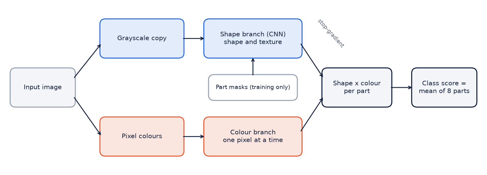
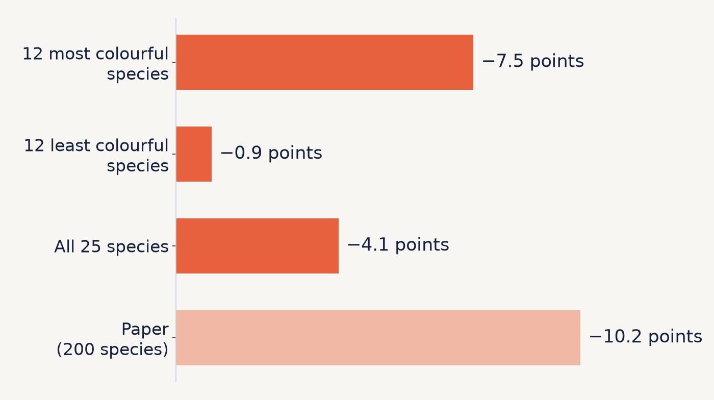

# Reproducing LucidPPN: Interpretable Bird Classification with Separate Shape and Colour Evidence

**Team:** Rayyan Saeed (31629), Laksh Kumar (30598), Ahmad Mustafa Khan (30496)

**Paper:** Pach, Lewandowska, Tabor, Zieliński, Rymarczyk. *LucidPPN: Unambiguous Prototypical Parts Network for
User-centric Interpretable Computer Vision.* ICLR 2025.

**Code:** https://github.com/rayyansgit/lucidppn-reproduction. Branch `main`: reproduction (Milestone 2). Branch
`m3&m4`: experiment and deployment (Milestones 3-4).

## 1. Introduction and problem statement

Image classifiers rarely explain their decisions. Prototypical-part networks do: they classify an image by matching
its parts to parts of training images ("this part looks like that part of a Cardinal").

LucidPPN identifies two problems with these explanations:

1. **A match mixes shape, texture and colour.** The user cannot tell which one the model used.
2. **Prototypes of different classes sit on different body parts.** Two classes cannot be compared part by part.

LucidPPN fixes both by design. We reproduced the method on a subset of a bird dataset, tested one of its claims with
our own experiment, and deployed the trained model as an application.

## 2. Background

- **ProtoPNet** (Chen et al., 2019): classification by comparing image patches with learned prototypes.
- **ProtoPShare, ProtoPool** (Rymarczyk et al., 2021, 2022): prototypes shared between classes.
- **PIP-Net** (Nauta et al., 2023): prototypes closer to human notions of a part; LucidPPN's main baseline.
- **Nauta et al. (2021)**: users often cannot tell whether a prototype matched on colour or shape.
- **PDiscoNet** (van der Klis et al., 2023): finds object parts using class labels only. LucidPPN uses its part masks.

## 3. Paper methodology

 <em>Figure 1. LucidPPN: shape and colour branches, combined per part.</em>

- **Shape branch.** A CNN sees only a grayscale copy of the image. For every part *k* and class *m* it produces a map
  of how much each location looks like part *k* of class *m*.
- **Colour branch.** A small network applied to one pixel at a time, so it learns colour but never shape.
- **Fusion.** Per part, evidence = shape map × colour map (best location). The class score is the mean over parts.
  The shape map is passed with a stop-gradient, so colour can confirm or block shape evidence but never changes what
  the shape branch learns.
- **Part alignment.** A training loss pushes each part's shape map towards PDiscoNet's mask for that part, so
  prototype *k* means the same body part in every class.

**Datasets:** CUB-200-2011, Stanford Cars, Stanford Dogs, Oxford Flowers. **Metrics:** top-1 accuracy, overlap of
prototype maps with part masks, user studies.

**Results on CUB (paper):**

| | Accuracy |
|---|---|
| LucidPPN | 81.5 ± 0.4% |
| PIP-Net (baseline) | 84.3% |
| Shape branch alone | 80.4% |
| Under random colour (hue) changes: LucidPPN / shape branch | 81.9 → 71.7% / 80.3 → 80.3% |

## 4. Implementation details

We forked the authors' code and kept their model, losses and training step unchanged, so differences come from scale
and settings, not from re-implementation. We wrote the data preparation, training and evaluation scripts, the
experiments and the deployment. `PROVENANCE.md` lists the origin of every file.

**Pipeline:** (1) prepare the subset, (2) train PDiscoNet and save 8 part masks per image, (3) train LucidPPN with
those masks, (4) evaluate, (5) run the experiment, (6) deploy.

| | Paper | Ours |
|---|---|---|
| Species | 200 | 25 |
| Shape backbone | ConvNeXt-Tiny | ResNet18 (same 28 × 28 feature maps) |
| Parts per bird | 12 | 8 |
| Part detector | 448 px, 28 epochs | 224 px, 5 epochs (28 in a later study) |
| Training | 40 epochs, batch 64, learning rate 0.002 | 82 epochs, batch 32, learning rate 0.0005 |
| Runs | 3 | 12 models in total (3-4 per setting) |

**Process:** a one-batch check, an 8-species trial, then 25 species. Every run logs train and test accuracy per
epoch. Hardware: Google Colab (T4 GPU), then a laptop RTX 2080 for the multi-run study.

## 5. Dataset and preprocessing

**CUB-200-2011:** 11,788 photos of 200 North American bird species, with a bounding box and 15 marked body points
(beak, eye, wing, tail, ...) per bird.

**Our subset: the first 25 species by CUB's numbering.**

| | |
|---|---|
| Included | Black-footed, Laysan and Sooty Albatross; Groove-billed Ani; Crested, Least, Parakeet and Rhinoceros Auklet; Brewer's, Red-winged, Rusty and Yellow-headed Blackbird; Bobolink; Indigo, Lazuli and Painted Bunting; Cardinal; Spotted and Gray Catbird; Yellow-breasted Chat; Eastern Towhee; Chuck-will's-widow; Brandt's, Red-faced and Pelagic Cormorant |
| Images | 750 training (30 per species), 652 test, using CUB's official split |
| Omitted | The other 175 species, including most of CUB's hardest look-alike groups (sparrows, warblers, gulls, terns, vireos, wrens) |
| Why | Training time on free GPUs |

**Preprocessing (as in the paper):**
- Each photo is cropped to its bounding box.
- Training: resize to 232 px, random geometric changes and flips, random crop to 224 px. Colours are never altered,
  so the colour branch learns real colours.
- Testing: resize to 224 px.
- The shape branch receives a normalised grayscale copy; the colour branch receives the colour image.

**Consequence:** chance is 4% (not 0.5%), and the task is easier than the full dataset. Our accuracy cannot be
compared directly with the paper's. Most of our species are grey, brown or black, which matters for the colour
experiment (Section 7).

## 6. Reproduction results

We always report accuracy at the last epoch. Without a validation set, picking the best epoch would mean choosing on
the test set.

| Run | Change | Test accuracy |
|---|---|---|
| Jump 2 | 10 epochs, no part masks | 33.9% |
| Jump 3 | 10 epochs, with part masks | 41.6% |
| Jump 4 | 82 epochs, batch 32, longer warm-up | 81.9% |
| Jump 4, 4 runs | same settings repeated | **83.1 ± 1.0%** |
| Paper | 200 species, ConvNeXt-Tiny | 81.5 ± 0.4% |

 <em>Figure 2. Test (solid) and train (dashed) accuracy per epoch, Jumps 2-4.</em>

- **Part masks reduce overfitting:** +7.7 points at the same training accuracy; the train-test gap roughly halved.
- **Longer training gives most of the gain.** Accuracy levels off after about 40 epochs.
- **Run-to-run noise is about ±1-2 points.** Re-running Jump 4 with identical settings gave 84.0% instead of 81.9%.

**Follow-up study (3 runs per setting).**

| | 5-epoch part detector | 28-epoch part detector |
|---|---|---|
| Our settings (Jump 4) | 83.1 ± 1.0% | 83.0 ± 0.7% |
| Paper's settings (authors' launch script) | 81.0 ± 1.7% | 81.4 ± 2.0% |

- **The paper's settings score about 2 points lower here.** On 750 images, 40 epochs at batch 64 give 4× fewer
  training steps than ours.
- **A better part detector did not change accuracy, but improved where prototypes look.** Its parts match CUB's
  marked body points better (NMI 24.1 → 31.0), and prototypes trained with them land more consistently on the same
  body parts (17.6 → 20.8 and 18.1 → 22.6). This second score is PDiscoNet's metric applied to our prototypes; the
  LucidPPN paper does not report it, so we only use it to compare our own models.
- **Top-5 accuracy is 97-98%.** The most common errors are between look-alike dark species: Pelagic vs Brandt's
  Cormorant, Rusty vs Brewer's Blackbird, Black-footed vs Sooty Albatross (37% of all errors).

## 7. Additional experiment: ablation of the colour branch

**Question:** what does the colour branch add, and what does it cost when colours are misleading?

**Method:**
1. **Colour branch off.** Because of the stop-gradient, the shape branch never learns from colour. The shape branch
   inside a trained model is therefore the colour-free model, and no retraining is needed.
2. **Misleading colours.** Test images are recoloured with a random hue shift of up to 0.1, 0.25 or 0.5 of the colour
   wheel, keeping each pixel's brightness (the authors' method). The shape branch sees exactly the same image.
3. **Repeats.** All 12 trained models, 5 random recolourings each. Results are also split by how colourful each
   species is (Hasler and Süsstrunk colourfulness, measured on the test images).

**Results** (accuracy change in points, mean of 12 models; recoloured = hue shift up to 0.5):

| Test images | Colour branch adds (original colours) | Full model when recoloured | Shape only when recoloured |
|---|---|---|---|
| All 25 species | +1.4 (positive in 12 of 12 models) | −4.1 | 0.0 |
| 12 most colourful species | +1.7 | −7.5 | 0.0 |
| 12 least colourful species | +1.3 | −0.9 | 0.0 |
| Paper, 200 species | +1.4 | −10.2 | 0.0 |

 <em>Figure 3. Accuracy lost by the full model when test images are recoloured (shape only: 0 in every group).</em>

**Findings:**
- **Colour helps a little, consistently.** +1.4 points, the same as the paper. One model alone was not enough to show
  it (12 images fixed, 5 broken, p ≈ 0.14); over 12 models it is clear (p = 0.0005).
- **The two branches are truly separate.** The shape-only model loses exactly 0 points in every model.
- **The cost falls on colourful birds.** On the most colourful species, misleading colours cost 7.5 points and push the
  full model below the shape-only model in 11 of 12 models. Grey species lose under 1 point. Cardinal loses 29 points.

**Answer:** the paper's trade-off holds. Colour adds about 1.4 points but makes the model vulnerable to wrong
colours, and how vulnerable depends on how colourful the birds are. This is consistent with our smaller average loss
(−4.1) than the paper's (−10.2), since most of our species are dull.

## 8. Analysis and discussion

- **Our accuracy only looks like the paper's.** Our model is weaker, but our task is much easier (25 species, few
  look-alikes). The similar numbers are a coincidence.
- **Part supervision serves the explanation more than accuracy.** Part masks reduced overfitting, but a better part
  detector changed where prototypes look, not accuracy. Interpretability needs its own measurements.
- **Several prototypes often share one spot.** In many images several of the 8 parts focus on the head, so they act as
  one piece of evidence. The app shows this.
- **Noise matters.** Two early conclusions changed once we had several runs: the first colour gain was not
  significant, and the slow start of training was mainly caused by the low default learning rate, not by the warm-up design.
- **Settings depend on dataset size.** The paper's settings, designed for 8× more images, did not transfer.

**Limitations:**
- Reduced scale: 25 species, ResNet18, 8 parts, weaker part detector.
- The first 25 species are mostly dull; a colourful subset would test the colour question better.
- No validation set; some settings were chosen after seeing test results.
- Only hue changes were tested; user studies, the other datasets and the PIP-Net comparison were not reproduced.

## 9. Deployment

A **Streamlit** web app and a **FastAPI** REST API, sharing one inference module and the trained model (84.0%). Both run
on a laptop CPU; `run_demo.bat` / `run_demo.sh` install and start everything.

The app has three tabs:
1. **Prediction:** species, whether it is correct, top-3 scores.
2. **Explanation:** for each of the 8 parts, where the model looked, the matching part of a training bird (in grayscale,
   as the shape branch sees it), and whether the colour fits.
3. **Colour ablation:** full model and shape-only model side by side, with a slider that recolours the bird, plus the
   test-set results of Section 7.

 <em>Figure 4. The app's colour-ablation tab: Indigo Bunting recoloured by +0.40.</em>

In this example the recoloured Indigo Bunting is classified as a Painted Bunting by the full model, while the shape-only
model stays correct: Section 7's result on a single image.

## 10. Conclusion

We reproduced LucidPPN's full pipeline on 25 CUB species (83.1 ± 1.0%). Our ablation confirmed the paper's colour
trade-off: colour adds about 1.4 points, the shape branch is unaffected by recolouring, and the cost of misleading
colours falls on colourful species. The deployed app shows the method's explanation part by part and runs the ablation
live.

## 11. References

1. M. Pach, K. Lewandowska, J. Tabor, B. Zieliński, D. Rymarczyk. LucidPPN: Unambiguous Prototypical Parts Network for
   User-centric Interpretable Computer Vision. ICLR 2025.
2. C. Chen, O. Li, D. Tao, A. Barnett, C. Rudin, J. Su. This Looks Like That: Deep Learning for Interpretable Image
   Recognition. NeurIPS 2019.
3. M. Nauta, J. Schlötterer, M. van Keulen, C. Seifert. PIP-Net: Patch-Based Intuitive Prototypes for Interpretable
   Image Classification. CVPR 2023.
4. R. van der Klis, S. Alaniz, M. Mancini, C. Dantas, D. Ienco, Z. Akata, D. Marcos. PDiscoNet: Semantically
   Consistent Part Discovery for Fine-grained Recognition. ICCV 2023.
5. D. Rymarczyk, Ł. Struski, J. Tabor, B. Zieliński. ProtoPShare: Prototypical Parts Sharing for Similarity Discovery
   in Interpretable Image Classification. KDD 2021.
6. D. Rymarczyk, Ł. Struski, M. Górszczak, K. Lewandowska, J. Tabor, B. Zieliński. Interpretable Image Classification
   with Differentiable Prototypes Assignment. ECCV 2022.
7. M. Nauta, A. Jutte, J. Provoost, C. Seifert. This Looks Like That, Because ... Explaining Prototypes for
   Interpretable Image Recognition. ECML PKDD Workshops 2021.
8. C. Wah, S. Branson, P. Welinder, P. Perona, S. Belongie. The Caltech-UCSD Birds-200-2011 Dataset. Technical Report
   CNS-TR-2011-001, Caltech, 2011.
9. K. He, X. Zhang, S. Ren, J. Sun. Deep Residual Learning for Image Recognition. CVPR 2016.
10. Z. Liu, H. Mao, C.-Y. Wu, C. Feichtenhofer, T. Darrell, S. Xie. A ConvNet for the 2020s. CVPR 2022.
11. D. Hasler, S. Süsstrunk. Measuring Colourfulness in Natural Images. Proc. SPIE 5007, 2003.
