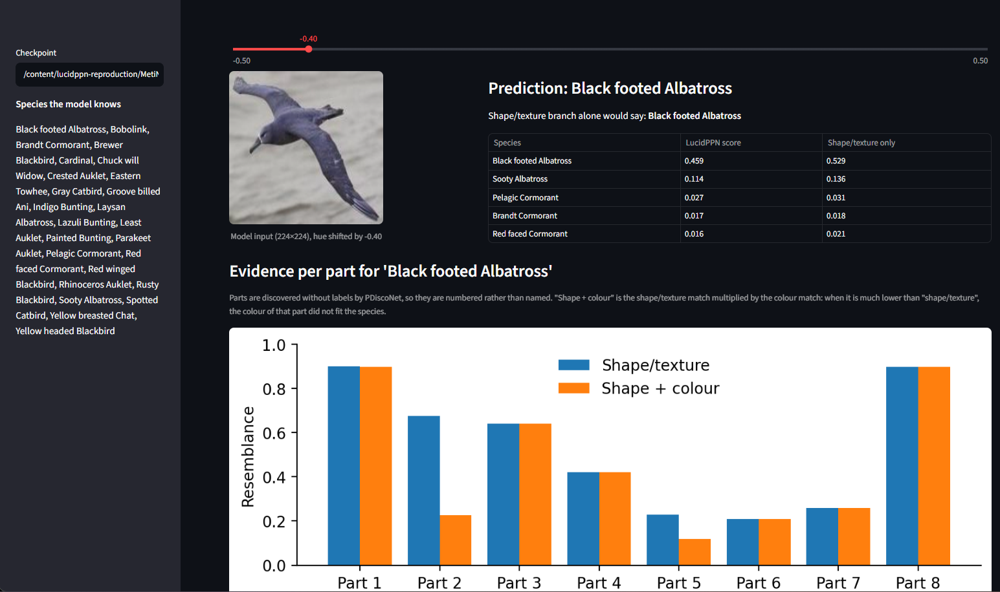
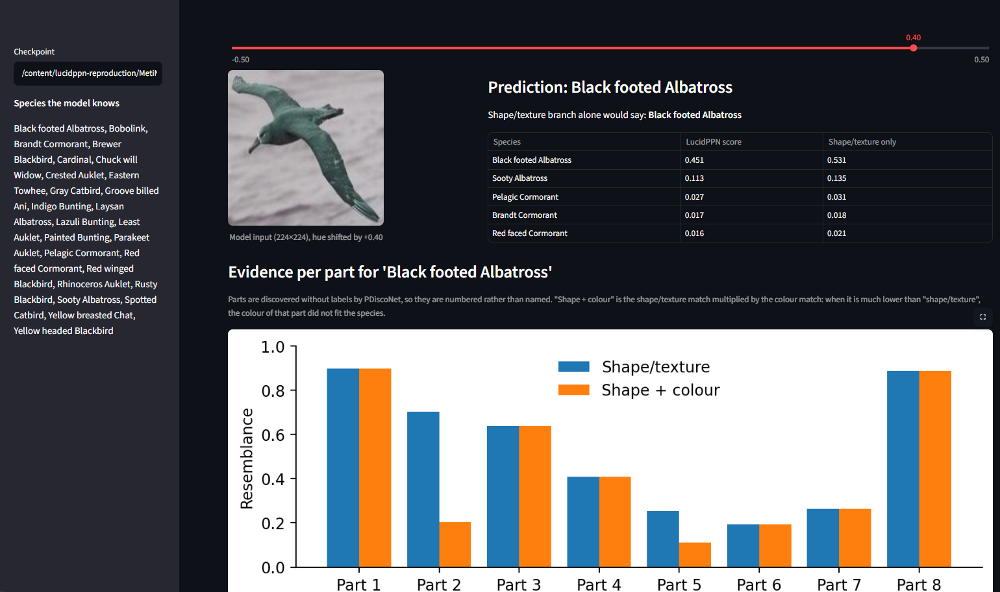
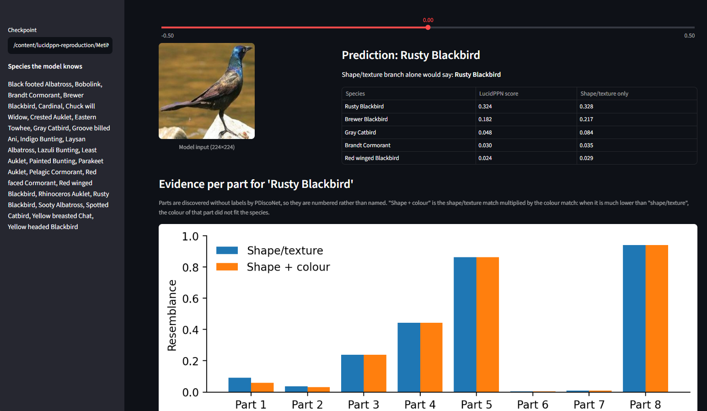
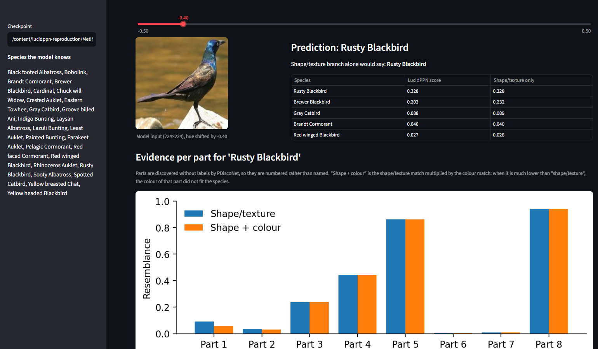
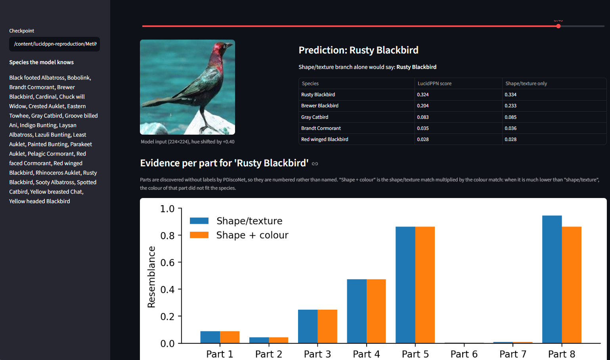

# Deployment (Stage 5)

Two front ends share one inference module (`lucid_inference.py`):

| | What it is | Start it |
|---|---|---|
| **Streamlit app** (`app.py`) | Web UI: upload a bird photo or pick a test image, see the top-5 species as a share-of-evidence bar chart (and, for test images, whether the prediction is correct), per-part shape vs colour evidence, prototype heatmaps, and a hue slider that recolours the bird live | `streamlit run deploy/app.py` |
| **REST API** (`api.py`) | FastAPI service returning JSON; interactive docs at `/docs` | `uvicorn deploy.api:app --port 8000` |

Both run on an ordinary laptop CPU (the checkpoint loads in about 0.2 s and each prediction takes about 0.1 s) or on
a GPU. No GPU and no Colab are needed for the demo.

## 1. Setup

### On your own computer, one click (recommended)
Clone the repository, then:
- **Windows:** double-click `run_demo.bat` in the repository folder.
- **macOS / Linux:** run `bash run_demo.sh` from the repository folder.

The first run creates a `.venv` folder and installs CPU PyTorch and Streamlit (about 5-10 minutes, needs internet).
Every later run starts the app in a few seconds, and works offline. The app opens at http://localhost:8501. The only
prerequisite is Python 3.10-3.13 (from python.org; on Windows, tick "Add python.exe to PATH" during installation).

Everything else is in the repository:
- `MetiNet/checkpoint_quick_train.pt`: the trained model (Jump 4 rerun, 46 MB). It is the one `.pt` file `.gitignore`
  lets through.
- `deploy/examples/`: one CUB test image per species, used by the "Example from test set" picker. If you have run
  `prepare_cub_subset.py`, the picker uses the full 652-image test set in `CUB_subset/test/` instead.

To use a different checkpoint, set the `LUCID_CHECKPOINT` environment variable to its path.

### On your own computer, manually
From the repository root, create and activate a virtual environment (`python -m venv .venv`, then
`.venv\Scripts\activate` on Windows or `source .venv/bin/activate` elsewhere), and run:
```bash
pip install torch torchvision --index-url https://download.pytorch.org/whl/cpu
```
```bash
pip install -r deploy/requirements.txt
```
```bash
streamlit run deploy/app.py
```

### On Colab
`notebooks/stage4_stage5_colab.ipynb` (Stage 5 section) starts both front ends and prints a public
`trycloudflare.com` link. The link only works while that Colab session is running.

## 2. Input format
- **Streamlit:** a JPG/PNG file upload, or a test image picked from `CUB_subset/test/` if that folder exists.
- **API:** `POST /predict` with a multipart form field `file` (the image). Optional query parameters:
  `top_k` (1-25, default 5) and `hue_shift` (-0.5 to 0.5, default 0).

The model was trained on images cropped to the bird's bounding box, so a tight crop around the bird works best.
Only the 25 species listed by `GET /classes` are known; any other bird is forced into one of them.

Preprocessing is the same as the paper's test-time pipeline: resize to 224×224. ColorNet sees the RGB pixels, and
ShapeTexNet sees a grayscale copy normalised with mean 0.445 and std 0.269. Part maps are not needed at inference.

## 3. Output format
A real response from our trained checkpoint (shortened to 3 parts; the full response is in
[`example_response_cardinal.json`](example_response_cardinal.json)):
```json
{
  "prediction": "Cardinal",
  "shapetexnet_prediction": "Cardinal",
  "hue_shift": 0.0,
  "top_k": [
    {"class": "Cardinal", "class_index": 4, "lucidppn_score": 0.7252, "share_of_evidence": 0.714, "shapetexnet_score": 0.7257},
    {"class": "Painted Bunting", "class_index": 14, "lucidppn_score": 0.0754, "share_of_evidence": 0.0742, "shapetexnet_score": 0.0875},
    {"class": "Gray Catbird", "class_index": 8, "lucidppn_score": 0.0688, "share_of_evidence": 0.0678, "shapetexnet_score": 0.1737}
  ],
  "parts": [
    {"part": 1, "shape_texture": 0.7289, "shape_plus_colour": 0.7289},
    {"part": 2, "shape_texture": 0.8109, "shape_plus_colour": 0.8108},
    {"part": 3, "shape_texture": 0.9953, "shape_plus_colour": 0.9912}
  ]
}
```
- `lucidppn_score`: the full model's score for a class (mean over the 8 parts of shape match × colour match, in 0-1).
  The model scores every species independently (one sigmoid per species, trained with binary cross-entropy), so these
  scores do not add up to 1.
- `share_of_evidence`: `lucidppn_score` divided by the sum over all 25 species. It adds up to 1 (100%) and reads like
  the model's belief over species, which is what the app's bar chart shows. It is not a calibrated probability.
- `shapetexnet_score`: the grayscale (shape/texture) branch alone.
- `parts`: evidence for the predicted class, per part. When `shape_plus_colour` is much lower than `shape_texture`,
  that part has the right shape but the wrong colour for the species.
- Parts are discovered by PDiscoNet without labels, so they are numbered, not named.

## 4. Worked example
```bash
uvicorn deploy.api:app --port 8000
```
```bash
curl -F "file=@CUB_subset/test/Cardinal/Cardinal_0001_17057.jpg" "http://localhost:8000/predict?top_k=3"
```
```bash
curl -F "file=@CUB_subset/test/Cardinal/Cardinal_0001_17057.jpg" "http://localhost:8000/predict?top_k=3&hue_shift=0.5"
```
Both responses are in [`example_response_cardinal.json`](example_response_cardinal.json). What they show:

| | Normal colours | Hue shifted by 0.5 (red → cyan) |
|---|---|---|
| Prediction | Cardinal | Cardinal |
| LucidPPN score for Cardinal | 0.725 | **0.368** (halved) |
| Share of evidence for Cardinal | 71% | **46%** (Gray Catbird rises to 21%) |
| Shape/texture-only score | 0.726 | 0.727 (unchanged) |
| Parts 1, 2, 3, 7: shape + colour | 0.33-0.99 | **≈ 0** |
| Parts 4, 5, 6, 8: shape + colour | unchanged | unchanged |

The shape branch is unaffected, because the recolouring keeps brightness. For four of the eight parts the colour
evidence collapses: those are the parts where the cardinal's red matters. The other four parts carry no colour
evidence for this species. The prediction survives only because the shape evidence is strong. This is the Stage 4
finding on a single image, and it shows LucidPPN's selling point: the explanation tells you which parts matched on
colour and which on shape.

Error handling: a non-image upload returns `400 {"detail": "file is not an image"}`, and a `hue_shift` outside
[-0.5, 0.5] returns `400`.

## 5. Screenshots
App running the trained checkpoint on Colab (Black-footed Albatross and Rusty Blackbird test images):

| Full page: prediction, top-5, part evidence, prototype heatmaps |
|---|
|  |

| Albatross, hue −0.40 | Albatross, hue +0.40 |
|---|---|
|  |  |

| Rusty Blackbird, hue 0 | Rusty Blackbird, hue −0.40 | Rusty Blackbird, hue +0.40 |
|---|---|---|
|  |  |  |

Both birds keep their prediction under strong hue shifts. The dark Rusty Blackbird's LucidPPN score doesn't move
(0.324 → 0.328 / 0.324). The grey albatross loses about 15% (0.530 → 0.459 / 0.451), all of it from two parts (2 and
5) whose colour evidence drops; the other six parts are unaffected. Compare the red cardinal above, whose score
halves (0.725 → 0.368). The more colourful the species, the more a hue change matters.

## Tested
- The API (valid image, invalid file, hue shift) and the Streamlit app (example picker, prediction table, part chart,
  heatmaps) were run on Colab with the trained checkpoint; screenshots and responses above.
- The same checkpoint was loaded and run locally on Windows/CPU (0.2 s to load, about 0.1 s per prediction). Its
  outputs for the Cardinal example match the Colab API responses to four decimals.
- `run_demo.bat` was tested on Windows from a clean folder containing exactly the files a clone would have: it
  created `.venv`, installed everything, started the app, and the example picker used `deploy/examples/`.
  `run_demo.sh` was not tested on macOS/Linux.
