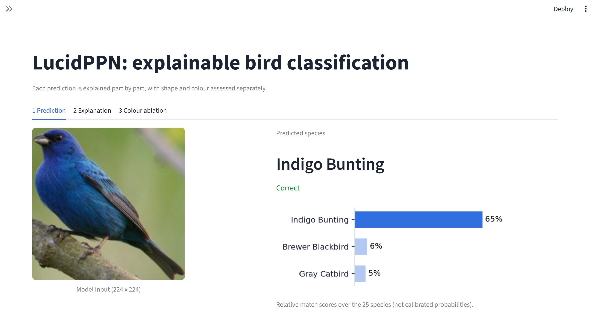
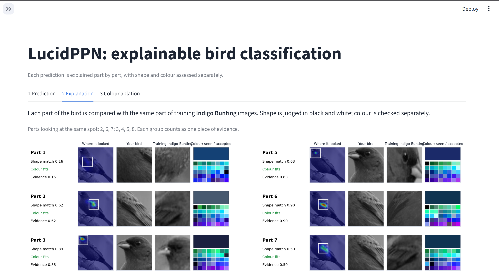
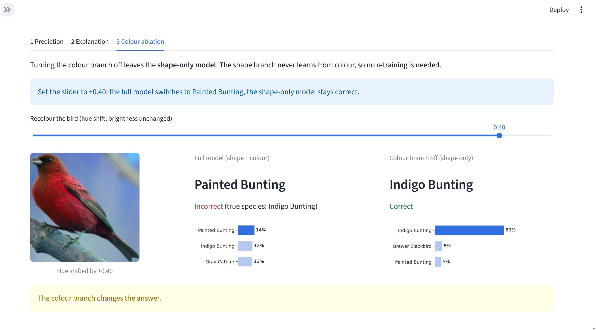

# Deployment

Two front ends share one inference module (`lucid_inference.py`) and the trained checkpoint
(`MetiNet/checkpoint_quick_train.pt`, the Jump 4 rerun, 84.0% test top-1 on our 25 species).

| | What it is | Start it (from the repository root) |
|---|---|---|
| Streamlit app (`app.py`) | Interactive demo: prediction, part-by-part explanation, colour-branch ablation | `streamlit run deploy/app.py` |
| REST API (`api.py`) | FastAPI service returning JSON; interactive docs at `/docs` | `uvicorn deploy.api:app --port 8000` |

Both run on a laptop CPU: the model loads in under a second and a prediction takes about 0.1-0.2 s. No GPU, no
dataset and no Colab are needed.

## 1. Setup

**One click:** `run_demo.bat` (Windows) or `bash run_demo.sh` (macOS/Linux). The first run creates `.venv` and installs
CPU PyTorch and Streamlit (5-10 minutes, needs internet); later runs start in seconds. Needs Python 3.10-3.13. The app
opens at http://localhost:8501.

**Manually:**
```bash
python -m venv .venv
.venv/bin/pip install torch torchvision --index-url https://download.pytorch.org/whl/cpu   # Windows: .venv\Scripts\pip
.venv/bin/pip install -r deploy/requirements.txt
.venv/bin/streamlit run deploy/app.py
```

Start the app from the repository root so that `.streamlit/config.toml` (light theme) is used.

**Optional, the full test set:** with `CUB_200_2011/` in the repository root, `python prepare_cub_subset.py` writes the
25-class subset to `CUB_subset/`. The app then offers all 652 test images (instead of one per species) and shows the
full training image behind each prototype. `CUB_subset/` is not committed: CUB-200-2011 images are licensed for
non-commercial research only and are not redistributed here.

## 2. The app

The sidebar picks the image: **guided examples** (five birds chosen to show one thing each), any **test image** by
species, or an **upload**. Three tabs:

1. **Prediction.** Predicted species, whether it is correct, and the top 3 relative match scores.
2. **Explanation.** For each of the 8 parts: where its prototype fires on the image (heatmap), the image patch there,
   the matching patch of a training image of the predicted species, and the colour check (the colour on the bird and
   the colours the colour branch accepts for that part of that species). Shape patches are grayscale because the
   shape branch only sees grayscale. Parts whose prototypes peak at the same spot are listed, since they are not
   independent evidence. A comparison chart lines up the 8 parts of the prediction against any other species.
3. **Colour ablation.** The full model next to the shape-only model (colour branch off) on the same image, with a hue
   slider that recolours the bird while keeping brightness, and a per-part chart of what the colour check blocked.
   Below, the test-set results of our experiment are read from `experiments/*/ablation/ablation.json` and
   `experiments/colour_by_species.json`.

Suggested demo: Cardinal (tabs 1-2), Indigo Bunting in tab 3 at hue +0.40 (the full model switches to Painted Bunting,
shape-only stays correct), then the test-set charts, then Least Auklet (an incorrect, low-confidence prediction).

| Prediction | Explanation | Colour ablation |
|---|---|---|
|  |  |  |

## 3. API

**Input:** `POST /predict` with a multipart field `file` (JPG or PNG). Optional query parameters: `top_k` (1-25,
default 5) and `hue_shift` (-0.5 to 0.5, default 0). `GET /classes` lists the 25 species.

**Output** (shortened; full responses in [`example_response_cardinal.json`](example_response_cardinal.json)):
```json
{
  "prediction": "Cardinal",
  "shapetexnet_prediction": "Cardinal",
  "hue_shift": 0.0,
  "top_k": [
    {"class": "Cardinal", "class_index": 4, "lucidppn_score": 0.7252, "share_of_evidence": 0.714, "shapetexnet_score": 0.7257}
  ],
  "parts": [
    {"part": 1, "shape_texture": 0.7289, "colour_match": 1.0, "shape_plus_colour": 0.7289, "location": [13, 11],
     "grid": 28, "pixel_colour": [121, 64, 52], "colour_space_accepted": 0.39}
  ],
  "parts_at_same_spot": [[1, 4], [2, 3, 5, 6, 8]],
  "comparison": {"class": "Painted Bunting", "lucidppn_score": 0.0754, "parts": ["..."]}
}
```

| Field | Meaning |
|---|---|
| `lucidppn_score` | Full-model score of a species: mean over the 8 parts of shape x colour evidence (0-1). Each species is scored independently, so scores do not sum to 1. |
| `share_of_evidence` | `lucidppn_score` divided by the sum over the 25 species. A relative score, not a calibrated probability. |
| `shapetexnet_score`, `shapetexnet_prediction` | The shape-only model (colour branch off). |
| `shape_texture` | Shape/texture match of a part (max over the image of the grayscale prototype map). |
| `colour_match` | Share of that shape evidence the colour check lets through (1 = colour fits, 0 = colour blocks the part). |
| `shape_plus_colour` | Evidence the prediction uses for that part (shape x colour). |
| `location`, `grid` | Cell of the 28 x 28 feature map where the part's prototype is strongest. |
| `pixel_colour` | The colour the colour branch saw there (RGB). |
| `colour_space_accepted` | Share of all RGB colours the colour branch accepts for this part of this species (1.0 = colour not used). |
| `parts_at_same_spot` | Groups of parts whose prototypes peak within 16 px of each other. |
| `comparison` | The same per-part evidence for the second-best species. |

Errors: a non-image upload returns `400 {"detail": "file is not an image"}`; a `hue_shift` outside [-0.5, 0.5]
returns `400`.

## 4. Worked example

```bash
uvicorn deploy.api:app --port 8000
curl -F "file=@deploy/examples/Cardinal/Cardinal_0001_17057.jpg" "http://localhost:8000/predict?top_k=3"
curl -F "file=@deploy/examples/Cardinal/Cardinal_0001_17057.jpg" "http://localhost:8000/predict?top_k=3&hue_shift=0.5"
```

| | Original colours | Hue shifted by 0.5 (red becomes cyan) |
|---|---|---|
| Prediction (full / shape-only) | Cardinal / Cardinal | Cardinal / Cardinal |
| Full-model score for Cardinal | 0.725 | 0.367 |
| Share of evidence for Cardinal | 71% | 45% |
| Shape-only score for Cardinal | 0.726 | 0.726 |
| Parts blocked by colour | none | 1, 2, 3, 7 |

The recolouring keeps brightness, so the shape branch sees the same image and its score does not move. The colour
check blocks the four parts whose accepted colours are reds and oranges; the other four parts accept any colour. The
prediction survives because the shape evidence is strong. On the Indigo Bunting the same test (hue +0.40) changes the
full model's answer to Painted Bunting while the shape-only model stays correct.

## 5. Notes and limits

- Only the 25 training species are known; any other bird is assigned to one of them.
- The model was trained on bounding-box crops, so tight crops work best.
- Parts are discovered without labels (PDiscoNet), so they are numbered, not named.
- The accepted-colour grid is our visualisation: it evaluates the trained colour branch on a 16 x 16 x 16 RGB grid.
  The paper instead shows colour patches from training images.
- Preprocessing follows the test-time pipeline in `MetiNet/util/data.py`: resize to 224 x 224; the shape branch gets a
  grayscale copy normalised with mean 0.445 and std 0.269, the colour branch the RGB image downsampled to 28 x 28.

The app recolours exactly as the authors' evaluation does (hue rotated, each pixel rescaled to its original
luminance, no clipping), so the shape-only scores are identical at every hue shift; we checked this on all 25 bundled
images at six hue shifts. An earlier version of the app clipped colours to [0, 1], which changed the luminance of
saturated pixels and could change the shape-only answer.

**Tested:** the app on all 25 bundled test images and all guided examples at several hue shifts, the comparison view
and upload mode (Streamlit's AppTest, no exceptions); the API for a valid image, a non-image file, an out-of-range hue
and a missing file. The Cardinal and Albatross numbers above match the earlier Colab runs to four decimals.
